<div align="center">

# 🥗 FoodCue
### *Know your food. Manage your kitchen.*

A local-first, privacy-conscious packaged food intelligence and kitchen-management Progressive Web Application (PWA).

[](https://food-cue.vercel.app/)
[](https://food-cue.vercel.app/)
[](https://github.com/parth022002/FoodCue)
[](https://github.com/parth022002/FoodCue)
[](https://github.com/parth022002/FoodCue)
[](https://neon.tech)
[](https://clerk.com)
[](LICENSE)

<br/>

**Architect & Developer:** [Parth Ahuja](https://github.com/parth022002) &bull; **Live Website:** [https://food-cue.vercel.app/](https://food-cue.vercel.app/) &bull; **Repository:** [parth022002/FoodCue](https://github.com/parth022002/FoodCue)

<br/>

<a href="https://food-cue.vercel.app/" target="_blank">
  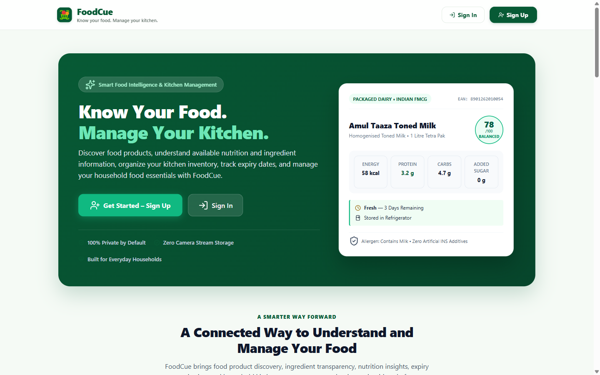
</a>

*Live Production Website Snapshot — Visit [food-cue.vercel.app](https://food-cue.vercel.app/)*

</div>

---

## 📖 Table of Contents

- [Live Production Deployment](#-live-production-deployment)
- [Overview & Problem Statement](#-overview--problem-statement)
- [Live Application Tour & Screenshots](#-live-application-tour--screenshots)
  - [1. Live Landing & Hero Showcase](#1-live-landing--hero-showcase)
  - [2. Interactive Feature Previews (Direct from Live Site)](#2-interactive-feature-previews-direct-from-live-site)
  - [3. Comprehensive 11-Capability Matrix](#3-comprehensive-11-capability-matrix)
  - [4. Seamless 4-Step Food Management Flow](#4-seamless-4-step-food-management-flow)
  - [5. Responsive Mobile Experience (iPhone Viewport)](#5-responsive-mobile-experience-iphone-viewport)
  - [6. Polished & Redesigned Footer (Developer Credit)](#6-polished--redesigned-footer-developer-credit)
- [Core Application Features](#-core-application-features)
  - [SmartScan Barcode & Packaging Intelligence](#smartscan-barcode--packaging-intelligence)
  - [Digital Kitchen & FIFO Expiry Tracking](#digital-kitchen--fifo-expiry-tracking)
  - [Personalized Authenticated Dashboard](#personalized-authenticated-dashboard)
  - [Multi-Tenant Household Sharing](#multi-tenant-household-sharing)
  - [Cloud Sync & Multi-Device Reconciliation](#cloud-sync--multi-device-reconciliation)
- [System Architecture & Data Flow](#-system-architecture--data-flow)
  - [High-Level Architecture](#high-level-architecture)
  - [SmartScan Processing Pipeline](#smartscan-processing-pipeline)
  - [Multi-Tier Product Resolution](#multi-tier-product-resolution)
- [Deterministic Food Safety & Health Scoring](#-deterministic-food-safety--health-scoring)
- [Security, Privacy & Tenant Isolation](#-security-privacy--tenant-isolation)
- [Tech Stack](#-tech-stack)
- [Project Structure & Canonical Docs](#-project-structure--canonical-docs)
- [Getting Started & Local Development](#-getting-started--local-development)
- [Automated Testing Suite](#-automated-testing-suite)
- [Production Deployment Guide](#-production-deployment-guide)
- [Author & Credits](#-author--credits)

---

## 🌐 Live Production Deployment

FoodCue is deployed to production on Vercel at **[https://food-cue.vercel.app/](https://food-cue.vercel.app/)**.

| Attribute | Details |
|---|---|
| **Production URL** | [https://food-cue.vercel.app/](https://food-cue.vercel.app/) |
| **Hosting Platform** | Vercel Edge Network |
| **Serverless Backend** | 11 Consolidated ESM Handlers (Vercel Hobby Plan Compliant) |
| **Database** | Neon Serverless PostgreSQL with Pooled Connections |
| **Authentication** | Clerk Identity Platform |
| **Offline Capability** | 100% Functional Client-Side IndexedDB PWA |

---

## 📸 Live Application Tour & Screenshots

*All screenshots below are captured directly from the live production deployment at [https://food-cue.vercel.app/](https://food-cue.vercel.app/).*

### 1. Live Landing & Hero Showcase

The public landing page introduces consumers to FoodCue’s privacy-first architecture, showing zero mandatory login friction, instant camera processing guarantees, and an interactive dairy product demonstration (Amul Taaza Toned Milk with deterministic Health Score 78/100).

<div align="center">
  <a href="https://food-cue.vercel.app/" target="_blank">
    
  </a>
  <p><sub><i>Figure 1: Desktop landing view at <a href="https://food-cue.vercel.app/">food-cue.vercel.app</a> showing brand identity, action buttons, and live health score preview.</i></sub></p>
</div>

---

### 2. Interactive Feature Previews (Direct from Live Site)

Visitors on [food-cue.vercel.app](https://food-cue.vercel.app/) can toggle between interactive tabs to preview FoodCue's four primary workflows:

#### A. SmartScan Barcode Decoding
Sub-100ms camera decoding powered by WebAssembly, with full hardware zoom (1.0x–5.0x), flashlight torch toggle, and front/back camera switching.

<div align="center">
  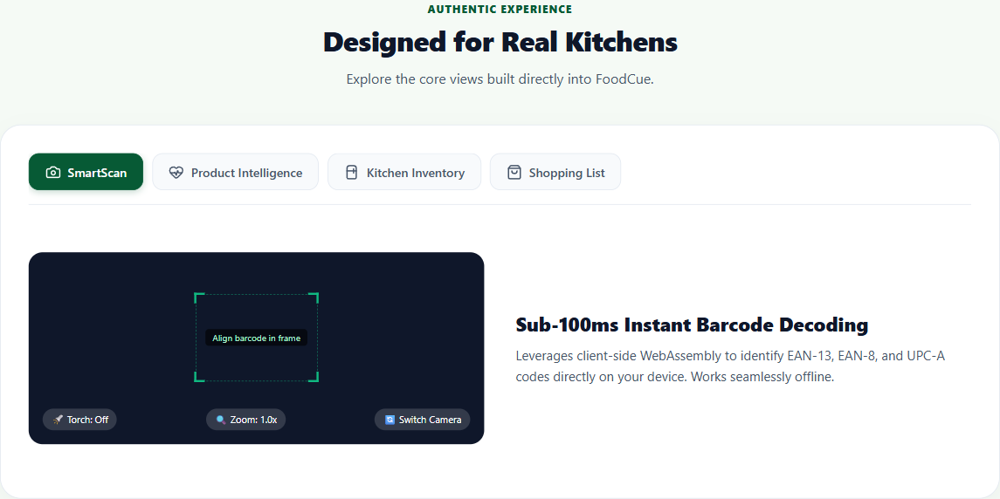
  <p><sub><i>Figure 2A: SmartScan viewfinder preview with camera controls and offline WASM decoding indicator.</i></sub></p>
</div>

#### B. Product Intelligence & Health Rating
Objective 0–100 nutritional scoring with breakdown of energy, added sugar, saturated fat, sodium, and ultra-processed INS additive alerts.

<div align="center">
  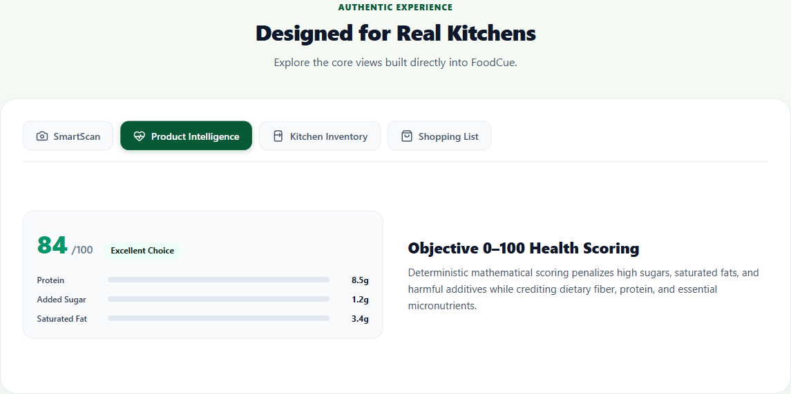
  <p><sub><i>Figure 2B: Product intelligence preview showing transparent nutrient grades and allergen screening.</i></sub></p>
</div>

#### C. Kitchen Inventory & FIFO Expiry
Digital kitchen organization sorting foods into Fridge, Pantry, and Freezer storage locations with real-time freshness badges.

<div align="center">
  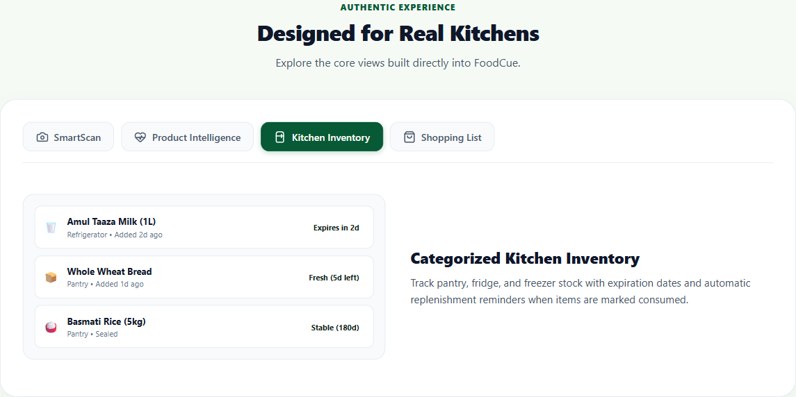
  <p><sub><i>Figure 2C: Digital pantry view showing color-coded expiry badges and consumption status.</i></sub></p>
</div>

#### D. Smart Replenishment Shopping List
Interactive grocery checklist that automatically populates when inventory items are consumed, preventing forgotten essentials.

<div align="center">
  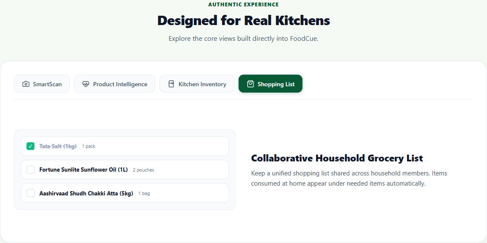
  <p><sub><i>Figure 2D: Smart shopping list preview with quick toggle checkboxes and categorization.</i></sub></p>
</div>

---

### 3. Comprehensive 11-Capability Matrix

FoodCue integrates 11 core capabilities into a single cohesive platform, spanning barcode scanning, nutrition profiling, additive analysis, allergen safeguards, inventory management, and household sharing:

<div align="center">
  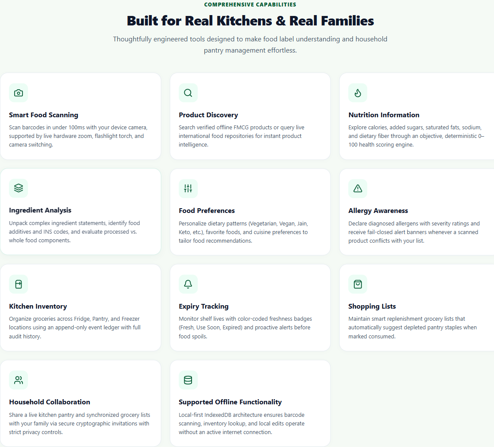
  <p><sub><i>Figure 3: Built for Real Kitchens & Real Families — 11 core capabilities live on <a href="https://food-cue.vercel.app/">food-cue.vercel.app</a>.</i></sub></p>
</div>

---

### 4. Seamless 4-Step Food Management Flow

From grocery store aisle discovery to organized household cooking:

<div align="center">
  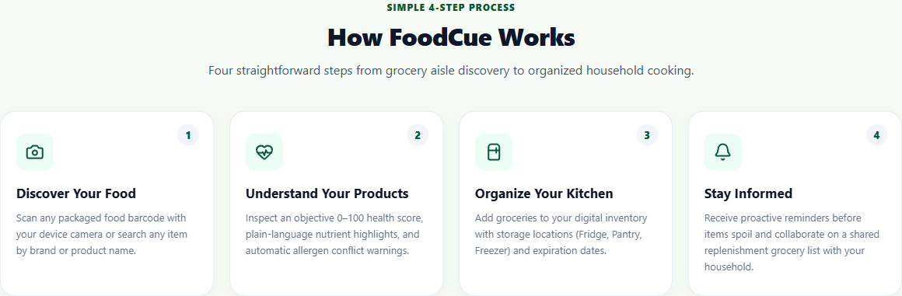
  <p><sub><i>Figure 4: How FoodCue Works — 4 intuitive steps from barcode scanning to collaborative replenishment.</i></sub></p>
</div>

---

### 5. Responsive Mobile Experience (iPhone Viewport)

Designed mobile-first with touch-optimized targets ($\ge 44\text{px}$), fluid typography, and responsive grid layouts tested on iPhone, iPad, Android, and Desktop viewports:

<div align="center">
  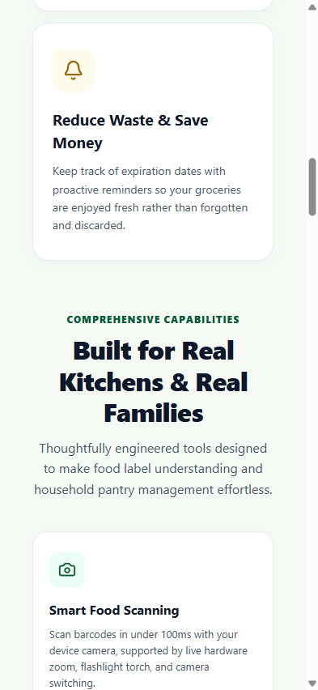
  <p><sub><i>Figure 5: Mobile viewport on iPhone (393px width) rendered live at <a href="https://food-cue.vercel.app/">food-cue.vercel.app</a>.</i></sub></p>
</div>

---

### 6. Polished & Redesigned Footer (Developer Credit)

A modern, clean footer featuring 4 organized columns, zero-border pill authentication buttons, streamlined legal links, and developer attribution (**Parth Ahuja**):

<div align="center">
  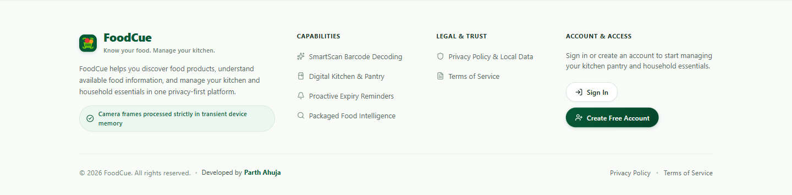
  <p><sub><i>Figure 6: Clean redesigned footer live at <a href="https://food-cue.vercel.app/">food-cue.vercel.app</a> showing developer attribution: <strong>Parth Ahuja</strong>.</i></sub></p>
</div>

---

## 📱 Core Application Features

### SmartScan Barcode & Packaging Intelligence

Scan standard 1D/2D barcodes (EAN-13, EAN-8, UPC-A, UPC-E, QR Code, GS1 Digital Link) in under 100ms. Instantly view nutrient grades, additive warnings, and allergen alerts.

<div align="center">
  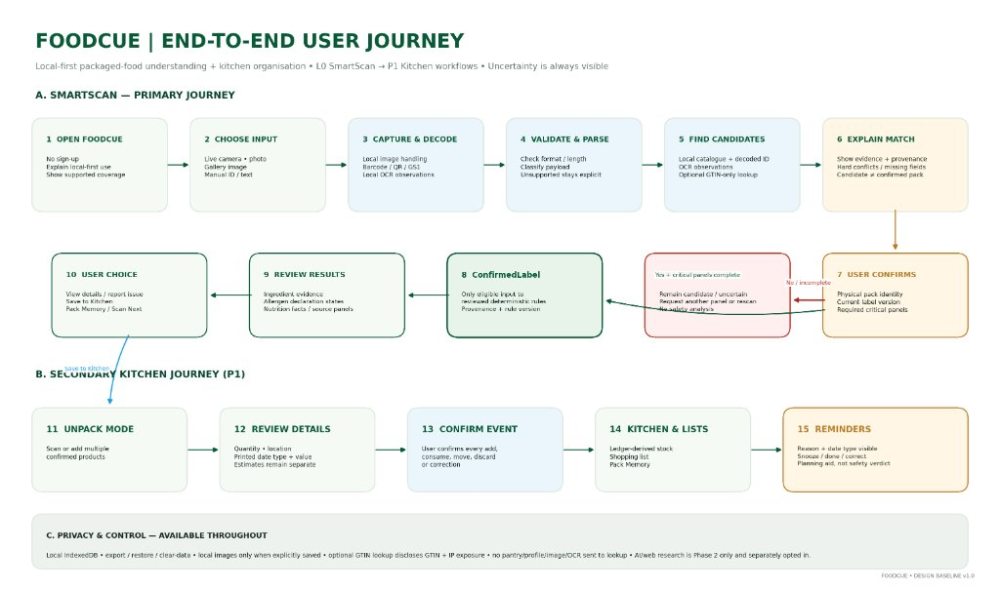
</div>

- **Instant Hardware Viewfinder:** Torch/flashlight control, hardware zoom slider, camera switcher, and tap-to-focus.
- **Fail-Closed Allergen Screening:** Cross-references ingredients against user dietary avoid-lists (Gluten, Lactose, Peanuts, Tree Nuts, Soy, Shellfish).
- **INS Additive Explainer:** Demystifies ultra-processed food additives (e.g., INS 621, INS 211, INS 150d) with health risk classifications.

---

### Digital Kitchen & FIFO Expiry Tracking

Track fresh produce, refrigerated items, and packaged groceries with First-In, First-Out (FIFO) consumption tracking.

<div align="center">
  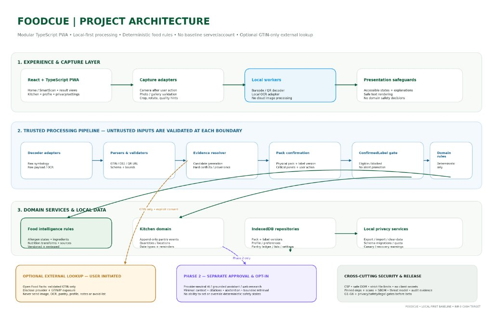
</div>

- **Expiry Urgency Radar:** Color-coded status badges (`Expired`, `Expiring Today`, `Within 3 Days`, `Fresh`).
- **Append-Only Consumption Ledger:** Maintains audit history of purchases, consumptions, and discards.
- **Smart Shopping List:** One-tap movement of depleted items into an interactive shopping checklist.

---

### Personalized Authenticated Dashboard

A unified command center for managing household food supplies, notification preferences, and personalized meal planning.

<div align="center">
  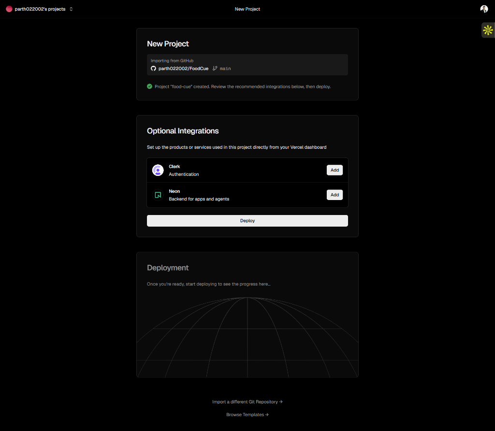
</div>

- **Summary Metric Cards:** Total stocked items, urgent expiry counts, active shopping items, and shared household members.
- **Quick Action Bar:** Direct access to SmartScan, inventory auditing, recipe discovery, and receipt scanning.
- **Recipe Engine:** Suggests balanced Indian and global recipes matching ingredients currently available in your pantry.

---

### Multi-Tenant Household Sharing

Collaborate with family members, roommates, or household staff in real-time.

<div align="center">
  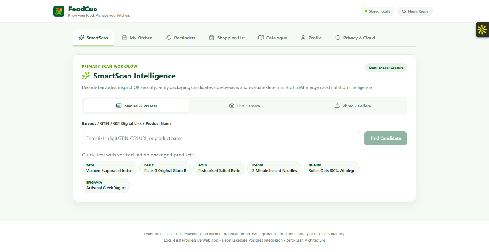
</div>

- **Role-Based Access Control (RBAC):** Assign granular roles (`Admin`, `Editor`, `Viewer`) to members.
- **Cryptographic Invite Links:** Generate shareable tokens with expiration timestamps, direct clipboard copy, and WhatsApp/SMS share triggers.
- **Multi-Tenant Isolation:** Complete database separation guaranteeing Household A's pantry is strictly invisible to Household B.

---

### Cloud Sync & Multi-Device Reconciliation

Seamlessly synchronize pantry items, shopping lists, and custom labels across laptops, tablets, and smartphones.

<div align="center">
  
</div>

- **Deterministic Last-Write-Wins (LWW):** Vector clocks and timestamps prevent overwrite conflicts during concurrent device edits.
- **Connected Devices Management:** Inspect all logged-in devices, active sessions, and revoke lost devices remotely.
- **Local-to-Cloud Migration Wizard:** Multi-step consumer onboarding that transfers local IndexedDB data safely to Neon PostgreSQL upon sign-in.

---

## 🏗️ System Architecture & Data Flow

### High-Level Architecture

FoodCue combines an offline-first client runtime with a serverless edge backend:

<div align="center">
  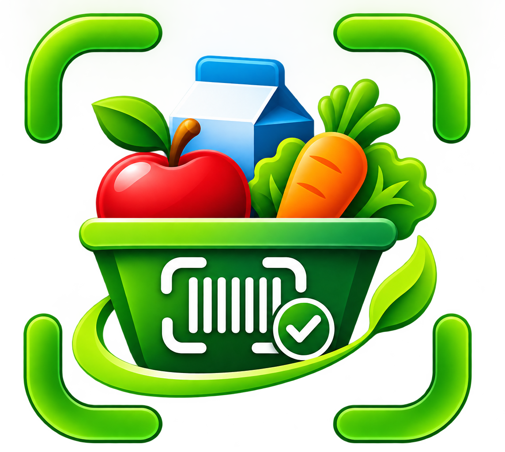
</div>

```
┌────────────────────────────────────────────────────────────────────────┐
│                          CLIENT RUNTIME (PWA)                          │
│                                                                        │
│   React 18 + TypeScript + Vite             IndexedDB (Dexie Storage)   │
│   ┌───────────────────────────────┐        ┌───────────────────────┐   │
│   │ SmartScan (ZXing WASM + OCR)  │        │ • Pantry Items        │   │
│   │ Consumption Event Ledger      │ ◄────► │ • Inventory Events    │   │
│   │ Local Product Cache (500 FMCG)│        │ • Shopping List       │   │
│   │ Conflict Resolution Engine    │        │ • User Preferences    │   │
│   └───────────────────────────────┘        └───────────────────────┘   │
└───────────────────────────────────┬────────────────────────────────────┘
                                    │ HTTPS (Bearer Token Auth)
                                    ▼
┌────────────────────────────────────────────────────────────────────────┐
│                   VERCEL SERVERLESS EDGE LAYER                         │
│                                                                        │
│   11 Consolidated ESM Handlers (Compliant with Vercel Hobby Quota):    │
│   • /api/health                   • /api/invitations                   │
│   • /api/me                       • /api/sharing                       │
│   • /api/devices                  • /api/account/delete                │
│   • /api/profile                  • /api/notifications/subscribe       │
│   • /api/households (Router)      • /api/sync (Router)                 │
│   • /api/webhooks/clerk (Svix HMAC-SHA256 Cryptographic Ingestion)     │
└───────────────────────────────────┬────────────────────────────────────┘
                                    │ Connection Pooling (Neon Serverless)
                                    ▼
┌────────────────────────────────────────────────────────────────────────┐
│                        NEON POSTGRESQL DATABASE                        │
│                                                                        │
│   • users                         • sync_operations (Idempotent)       │
│   • user_profiles                 • sync_devices                       │
│   • dietary_preferences           • households                         │
│   • food_allergies                • household_members                  │
│   • food_restrictions             • household_invitations              │
│   • pantry_items                  • foodcue_audit_log                  │
└────────────────────────────────────────────────────────────────────────┘
```

---

### SmartScan Processing Pipeline

Camera feed analysis operates completely on-device without streaming video frames to external servers:

<div align="center">
  
</div>

1. **Hardware Capture:** `getUserMedia` stream rendered to an HTML5 `<video>` element with hardware constraints.
2. **Transient Frame Extraction:** Canvas captures video frames in temporary browser memory.
3. **Multi-Format Decoding:** `@sec-ant/zxing-wasm` evaluates barcodes in parallel workers.
4. **Adaptive Preprocessing:** Grayscale conversion, CLAHE contrast enhancement, and adaptive binarization for low-light scanning.

---

### Multi-Tier Product Resolution

When a barcode is decoded, FoodCue queries multiple tiers in order of speed and privacy:

<div align="center">
  
</div>

- **Tier 1 (Instant Offline Catalog):** 500+ curated Indian FMCG products (Amul, Britannia, Parle, Tata, Nestlé, Haldiram's, Dabur) stored locally.
- **Tier 2 (Open Food Facts Database):** Global open-data fallback with compliant attribution.
- **Tier 3 (AI Web Search Engine):** Real-time web retrieval via Tavily for newly launched packaged products.

---

## 🥗 Deterministic Food Safety & Health Scoring

FoodCue computes an objective **0–100 Health Score** based on nutrient densities per 100g/ml:

$$\text{Health Score} = 100 - \left( W_{\text{energy}} \cdot E + W_{\text{satfat}} \cdot SF + W_{\text{sugar}} \cdot S + W_{\text{sodium}} \cdot Na + W_{\text{additives}} \cdot A \right)$$

- **Energy Density Penalty ($E$):** Scaled based on kcal/100g.
- **Saturated Fat Penalty ($SF$):** Penalizes high saturated lipid levels.
- **Free Sugar Penalty ($S$):** Strict penalties for refined added sugars.
- **Sodium Penalty ($Na$):** Highlights high-salt preservation.
- **Ultra-Processed Additive Penalty ($A$):** Deducts points for synthetic emulsifiers, artificial colors, and chemical preservatives.
- **Data Integrity Rule:** If a nutrient value is unlisted on the packaging, it is stored as `null`. It is **never assumed to be zero**, preventing false-positive "healthy" ratings.

---

## 🔒 Security, Privacy & Tenant Isolation

- **Transient Camera Pipeline:** Camera images are never saved to disk, never uploaded to a cloud server, and exist only as temporary pixels in volatile RAM during frame processing.
- **Cryptographic Webhook Validation:** Clerk webhooks (`POST /api/webhooks/clerk`) are authenticated using Svix HMAC-SHA256 signature verification with tolerance replay windows.
- **Multi-Tenant Horizontal Isolation:** Every cloud database operation strictly parameterizes `WHERE clerk_user_id = $1` or `WHERE household_id = $1`. Automated cross-tenant tests verify that User A cannot read or modify User B's inventory.
- **Audit Logging:** Security-critical actions (device authorizations, member revocations, cloud data deletions) are recorded in `foodcue_audit_log`.

---

## 💻 Tech Stack

| Domain | Technology | Purpose |
|---|---|---|
| **Frontend Framework** | React 18 + TypeScript 5.7 | Component architecture & strict type safety |
| **Bundler & Tooling** | Vite 6.0 + esbuild | Fast HMR & optimized production bundling |
| **Local Storage** | IndexedDB via Dexie.js | Offline persistence for pantry & scan ledger |
| **Barcode Engine** | `@sec-ant/zxing-wasm` | Multi-format 1D/2D barcode decoding in WebAssembly |
| **Authentication** | Clerk (`@clerk/react`, `@clerk/backend`) | Session tokens, organizations & user profile |
| **Serverless Backend**| Node.js ESM on Vercel | Consolidated API handlers (11 endpoints) |
| **Cloud Database** | Neon PostgreSQL Serverless | Connection pooling & parameterized persistence |
| **Native Wrappers** | Capacitor Android & iOS | Native camera & mobile packaging |
| **Icons & Styling** | Lucide React & Modern CSS3 | Accessible SVG icons & responsive design system |
| **Testing** | Vitest 2.1 + Testing Library | 290 automated tests covering unit, E2E & security |

---

## 📁 Project Structure & Canonical Docs

```text
FoodCue/
├── api/                             # Compiled Vercel Serverless Function entrypoints (11 ESM)
│   ├── account/delete.js            # Account deletion handler
│   ├── devices/index.js             # Device registration & revocation
│   ├── households/index.js          # Consolidated households & details router
│   ├── sync/index.js                # Consolidated sync (push, pull, migrate, status)
│   ├── health.js                    # Health check & database connection probe
│   ├── me.js                        # Authenticated user profile retrieval
│   ├── notifications/subscribe.js   # Web Push subscription handler
│   ├── profile/index.js             # User profile & dietary preference management
│   ├── sharing/index.js             # Household sharing & access controls
│   ├── invitations/index.js         # Member invitation token validation
│   └── webhooks/clerk.js            # Cryptographic Svix webhook receiver
├── src/
│   ├── adapters/                    # Hardware (camera, OCR, notifications, storage)
│   ├── components/                  # Navigation (Navbar, Footers), Brand (Logo), UI Cards
│   ├── domain/                      # Health scoring, GS1 parsers, safety rules, FMCG catalog
│   ├── features/                    # SmartScan, Pantry, Recipes, Receipts, Devices, Privacy
│   ├── server/                      # TypeScript endpoint implementations, repos, database client
│   └── sync/                        # Local change queue, conflict resolver, transport client
├── docs/
│   ├── screenshots/                 # Product walkthrough images & architecture diagrams
│   ├── architecture/                # System architecture, database schema, technical decisions
│   ├── product/                     # Product requirements, roadmap, user journeys
│   ├── security/                    # Threat modeling, authentication, tenant isolation
│   └── deployment/                  # Production deployment & operations guide
├── test/                            # 51 Vitest test suites (290 tests)
├── vercel.json                      # Vercel deployment & routing configuration
├── vite.config.ts                   # Vite configuration with optimized vendor chunking
└── package.json                     # Dependencies & scripts
```

---

## 🚀 Getting Started & Local Development

### Prerequisites

- **Node.js:** `Node.js >= 20.x` (LTS 20.x or 22.x recommended)
- **Package Manager:** `npm` (included with Node)
- **Database:** Free [Neon](https://neon.tech) PostgreSQL account

### Installation

```bash
# 1. Clone repository
git clone https://github.com/parth022002/FoodCue.git
cd FoodCue

# 2. Install dependencies
npm ci

# 3. Configure environment
cp .env.example .env
```

### Environment Configuration (`.env`)

```env
# Neon PostgreSQL Pooled Connection
DATABASE_URL="postgresql://foodcue_owner:<password>@ep-cool-lake-123456-pooler.us-east-2.aws.neon.tech/foodcue?sslmode=require"

# Clerk Authentication (Get from https://dashboard.clerk.com)
VITE_CLERK_PUBLISHABLE_KEY="pk_test_..."
CLERK_SECRET_KEY="sk_test_..."
CLERK_WEBHOOK_SECRET="whsec_..."

# Web Push Notification VAPID Keys
VITE_VAPID_PUBLIC_KEY="BEl62iUYg..."
VAPID_PRIVATE_KEY="YOUR_VAPID_PRIVATE_KEY"
```

### Running Locally

```bash
# Start local development server (http://127.0.0.1:5173)
npm run dev

# Run full production build (TypeScript + Vite + API bundler)
npm run build

# Preview production build locally
npm run preview
```

---

## 🧪 Automated Testing Suite

FoodCue maintains a comprehensive test suite of **51 test files and 290 individual tests**:

```bash
# Execute full Vitest suite
npm test

# Run tests in watch mode
npm run test:watch

# Execute TypeScript typechecking
npm run typecheck

# Execute ESLint validation
npm run lint
```

```text
✓ test/domain/packBenchmarkEvaluator.test.ts (8 tests)
✓ src/adapters/storage/database.test.ts (8 tests)
✓ test/adapters/notificationService.test.ts (7 tests)
✓ test/server/services/user.service.test.ts (7 tests)
✓ test/safety/foodSafetyAdversarial.test.ts (5 tests)
✓ test/e2e/phase11UserJourneys.test.ts (5 tests)
✓ test/domain/aiNutritionAgents.test.ts (10 tests)
✓ test/server/api/householdIsolation.test.ts (5 tests)
✓ test/server/api/endpoints.test.ts (21 tests)
✓ src/domain/rules/gs1Parser.test.ts (13 tests)
✓ test/features/responsiveDesign.test.tsx (8 tests)
✓ test/features/authAndInviteFlows.test.tsx (6 tests)
...
Test Files: 51 passed (51)
Tests:      290 passed (290)
Result:     100% Passing
```

---

## 🌐 Production Deployment Guide

FoodCue is live in production on Vercel at **[https://food-cue.vercel.app/](https://food-cue.vercel.app/)**:

1. **Live Production Endpoint:** [https://food-cue.vercel.app/](https://food-cue.vercel.app/)
2. **Vercel Hobby Plan Compliance:** All serverless routes are packaged into **11 ESM handlers** (well within the 12-function Hobby plan limit).
3. **Fluid Compute Support:** Configured for Active CPU billing with zero deprecated memory overrides.
4. **Automatic Cache Invalidation & CI/CD:** Commits pushed to `origin/main` automatically build and deploy across Vercel's global edge network.

To deploy your own instance:

```bash
# Push directly to GitHub main branch to trigger Vercel CI/CD
git push origin main
```

---

## 👨‍💻 Author & Credits

- **Creator & Lead Developer:** **Parth Ahuja**
  - **GitHub:** [@parth022002](https://github.com/parth022002)
  - **Email:** [parthahuja021102@gmail.com](mailto:parthahuja021102@gmail.com)
  - **Live Website:** [https://food-cue.vercel.app/](https://food-cue.vercel.app/)
  - **Repository:** [https://github.com/parth022002/FoodCue](https://github.com/parth022002/FoodCue)

---

<div align="center">
  <sub>Built with ❤️ by Parth Ahuja &bull; Live at <a href="https://food-cue.vercel.app/">food-cue.vercel.app</a> &bull; © 2026 FoodCue. All rights reserved.</sub>
</div>
