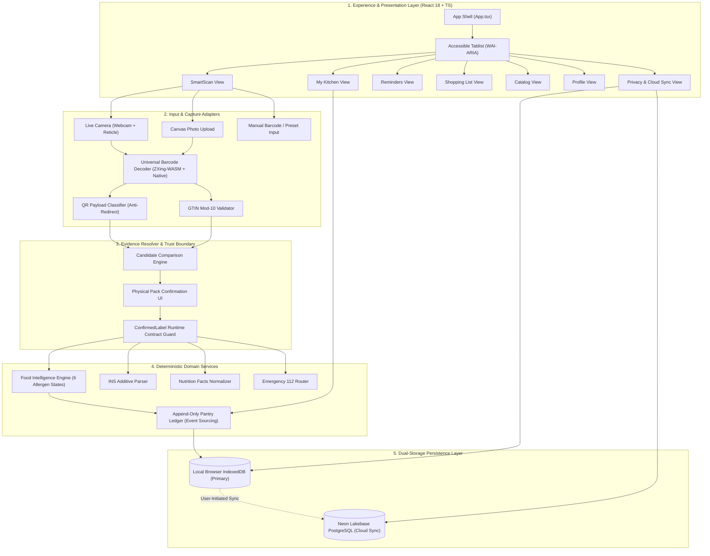

# FoodCue System Architecture — v2.0
**A Technical Blueprint for the Local-First Packaged-Food Intelligence & Kitchen Management PWA**

```text
========================================================================================
PROJECT:               FoodCue (Working Brand; Formerly SafeWise AI)
DOCUMENT TITLE:        System Architecture Specification
DOCUMENT VERSION:      v2.0 (Postgres Cloud Ready & Production Frontend Complete)
DATE:                  16 November 2026
PARENT SPECIFICATION:  FoodCue Master Specification v13.5 (Final Controlled Baseline)
PRODUCT SPECIFICATION: FoodCue Product Development Requirements Document (PRD) v1.3
STATUS:                Approved Technical Architecture
========================================================================================
```

---

## 1. Architectural Philosophy

FoodCue is designed around two foundational paradigms:
1. **Local-First Processing:** Image capture, barcode decoding, candidate ranking, deterministic food intelligence, append-only pantry tracking, and data storage operate entirely inside the user's browser without requiring a server or user account.
2. **Dual-Storage Cloud Sync:** Browser-native IndexedDB serves as the primary zero-latency persistence engine, while an optional Neon Lakebase Serverless PostgreSQL database provides cloud backup, multi-device sync, and audit logging over stateless HTTP connection pooling (`@neondatabase/serverless`).

---

## 2. High-Level Architecture Diagram



---

## 3. Layer Specifications

### 3.1 Experience & Presentation Layer
- **Framework:** React 18 with TypeScript 5.7, built via Vite 6.
- **Styling:** CSS Custom Properties implementing FoodCue Brand Guidelines v1.0 (Core Green `#075A35`, Cue Lime `#72C900`, Deep Leaf `#06452B`, Soft Surface `#F5FAF5`).
- **Accessibility:** WCAG 2.2 Level AA compliance, 4.5:1 text contrast ratios, visible focus indicators, screen-reader alert landmarks (`role="alert"`), and full keyboard navigation.

### 3.2 Capture & Decoder Adapters
- **Camera Viewfinder:** MediaDevices `getUserMedia` API bound to an HTML5 `<video>` element with custom CSS scan reticle and animated laser sweep. Camera media tracks are released immediately upon view change or unmount.
- **Universal Decoder (`src/adapters/barcode/barcodeService.ts`):** Progressive enhancement architecture. Tries browser-native `BarcodeDetector` first; falls back smoothly to portable `@sec-ant/zxing-wasm` WebAssembly. Supports EAN-13, EAN-8, UPC-A, UPC-E, QR Code, and DataMatrix.
- **QR Security Classifier (`src/domain/rules/payloadClassifier.ts`):** Parses QR payloads into GS1 Digital Link, standard HTTPS, plain text, and unsafe schemes. **Strictly prohibits automatic navigation, fetching, redirects, or URL expansion.**

### 3.3 The Evidence Resolver & ConfirmedLabel Boundary
- A scanned barcode or crowdsourced catalog entry is **never treated as verified proof of the physical pack**. Formulations and allergens change over time.
- Only when the user visually confirms the physical pack identity and verifies critical panels (`ingredients`, `allergen_declaration`, `nutrition`) can a runtime `ConfirmedLabel` object be constructed via `src/domain/contracts/confirmedLabel.ts`.
- The `isConfirmedLabel()` type guard strictly shields the food intelligence engine from unverified data.

### 3.4 Deterministic Food Intelligence Engine
- **Zero Generative AI in Core Safety:** Food-safety conclusions must never rely on LLM hallucinations.
- **Allergen State Model:** Evaluates Top 8 allergens (Wheat/Gluten, Milk, Peanuts, Tree Nuts, Soy, Egg, Fish, Crustaceans) plus Sulphites across 6 distinct states.
- **"Not Detected" Safety Shield:** The state `not_detected_in_extracted_text` is never displayed as "safe" or "allergen-free". It renders in a neutral tone with an explicit warning that absence in extracted text is not proof of total absence.
- **Emergency 112 Routing:** If an ingredient or emergency trigger keyword is detected, static offline guidance routes the user directly to India National Emergency 112.

### 3.5 Kitchen Event Sourcing Ledger
- **Append-Only Immutability:** Kitchen stock balances are not directly overwritten. Every stock intake, consumption, location move, discard, or correction appends an immutable event to `pantryEvents`.
- **Current Balance Projection:** The current inventory state is derived mathematically by folding the event sequence via `projectBalances()`.
- **Compensating Undo:** Undo actions append a compensating event (e.g. an `undo_consume` event) rather than deleting history.

---

## 4. Dual-Storage Architecture: IndexedDB + Neon PostgreSQL

| Capability | Local IndexedDB (`database.ts`) | Neon PostgreSQL (`neonDatabase.ts`) |
|---|---|---|
| **Role** | Primary local-first storage | Optional cloud backup & multi-device sync |
| **Availability** | 100% Offline (Zero Network) | Online (stateless HTTP fetch via `@neondatabase/serverless`) |
| **Object Stores / Tables** | 5 stores (`candidates`, `confirmedLabels`, `analysisResults`, `pantryEvents`, `settings`) | 10 relational tables matching `docs/schema.sql` |
| **Sync Protocol** | Event ledger append | Idempotent upsert (`ON CONFLICT (event_id) DO NOTHING`) |
| **Account Dependency** | None (Anonymous device storage) | None required (uses default local-user session; supports Clerk) |
| **Data Eviction Risk** | Browser storage eviction canary monitored | Durable cloud PostgreSQL storage in AWS Singapore |

---

## 5. Deployment Architecture

```text
GitHub Repo (parth022002/FoodCue)
       │ (Push to main)
       ▼
Vercel Edge Platform
  ├── Edge CDN Static Hosting (SPA bundle from dist/)
  ├── vercel.json SPA Rewrites (/(.*) -> /index.html)
  ├── Edge Security Headers (CSP, HSTS, X-Frame-Options)
  └── Service Worker Cache (sw.js offline fallback)
       │
       ▼ (Stateless HTTP Connection Pooling)
Neon Lakebase PostgreSQL (AWS Singapore ap-southeast-1)
```

---

```text
========================================================================================
END OF FOODCUE SYSTEM ARCHITECTURE (v2.0)
========================================================================================
```
