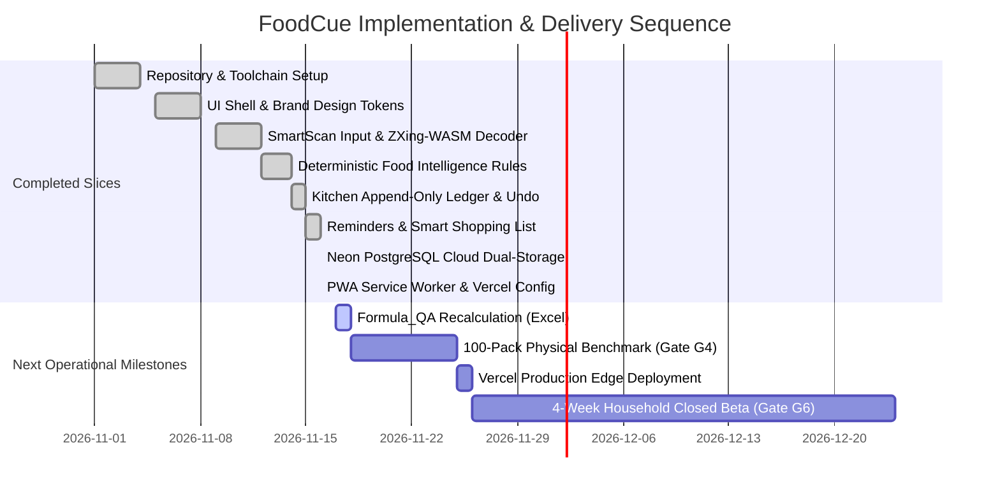

# FoodCue Development Roadmap & Release Milestones — v2.0

```text
========================================================================================
PROJECT:               FoodCue (Working Brand; Formerly SafeWise AI)
DOCUMENT TITLE:        Development Roadmap & Release Gate Sequence
DOCUMENT VERSION:      v2.0 (Postgres Cloud Ready & Production Frontend Complete)
DATE:                  16 November 2026
PARENT SPECIFICATION:  FoodCue Master Specification v13.5 (Final Controlled Baseline)
PRODUCT SPECIFICATION: FoodCue Product Development Requirements Document (PRD) v1.3
STATUS:                Sprint 1–3 Complete; Production Frontend Ready; Gate G4 Benchmark Roadmapped
========================================================================================
```

---

## 1. Implementation Progress Overview



---

## 2. Completed Milestones (Sprints 1–3)

### Milestone 1: Core Foundation & Domain Contracts (Passed)
- Node.js 20.18+ / npm 10+ toolchain verification and pinned `package-lock.json`.
- Strict TypeScript configuration (`strict: true`, `noUncheckedIndexedAccess: true`).
- Core domain entities: `ProductCandidate`, `ConfirmedLabel`, `PantryEvent`, `PantryItem`.
- Vitest automated test suite setup with 100% passing tests.

### Milestone 2: SmartScan Multi-Modal Pipeline (Passed)
- Live webcam viewfinder with animated laser reticle and explicit user-action permission.
- Canvas image picker and upload validation.
- `@sec-ant/zxing-wasm` WebAssembly barcode reader with native `BarcodeDetector` progressive enhancement.
- GTIN mod-10 check-digit validation algorithm (4 passing tests).
- QR payload security classifier and safe URL origin preview (4 passing tests).
- Guided multi-panel capture checklist (Front, Ingredients, Allergens, Nutrition).
- Side-by-side candidate comparison and physical pack confirmation flow.

### Milestone 3: Deterministic Food Intelligence Engine (Passed)
- 6-state allergen classification engine.
- Indian FSSAI mandatory allergen declarations (Wheat, Milk, Peanuts, Tree Nuts, Soy, Egg, Fish, Crustaceans, Sulphites).
- INS additive parsing (INS 500, INS 503, INS 322, INS 223, INS 621, INS 635, INS 160b).
- Free-From manufacturer claim conflict detection.
- Static offline emergency guidance routing severe reaction cues to India National Emergency 112.

### Milestone 4: Kitchen & Pantry Management (Passed)
- Append-only event ledger supporting `add`, `consume`, `adjust`, `move`, `discard`, and `correction`.
- Compensating event undo mechanism.
- Location filtering (All, Pantry, Fridge, Freezer, Use Soon).
- Date semantics distinguishing best-before from expiry.
- Rapid intake "Unpack Mode".
- Date-driven planning reminders with +2d snooze.
- Smart shopping list with "Add Depleted Items" helper and WhatsApp/CSV export.

### Milestone 5: Dual-Storage Database & Cloud Sync (Passed)
- Local IndexedDB persistence with 5 object stores.
- Storage quota estimation and eviction canary.
- Offline JSON export and validated backup restore.
- Neon Lakebase Serverless PostgreSQL integration in AWS Singapore (`ap-southeast-1`).
- 10-table production relational schema deployed and verified active (`docs/schema.sql`).
- Bidirectional pantry event sync and cloud restoration.

### Milestone 6: PWA Offline Shell & Vercel Deployment (Passed)
- Stale-while-revalidate Service Worker (`public/sw.js`).
- Web App Manifest (`public/manifest.webmanifest`).
- Production security headers in `public/_headers` and `vercel.json`.
- GitHub repository synchronized (`parth022002/FoodCue.git` on branch `main`).

---

## 3. Operational Release Gates Roadmap

| Gate | Gate Objective | Required Evidence | Target Date | Owner Action |
|---|---|---|---|---|
| **Gate G1** | Problem Validation | 20+ qualitative household grocery interviews | Nov 2026 | Interview notes in `docs/` |
| **Gate G2** | Domain Architecture Freeze | Pure TypeScript domain models, 0 TS errors, 100% passing tests | **PASSED** | Commit `70d0306` |
| **Gate G3** | Technical Alpha | Full PWA frontend, Neon DB active, SmartScan verified | **PASSED** | Codebase deployed |
| **Gate G4** | Physical Pack Benchmark | 100 Indian pack photos (40 held-out release set) with ground truth | Nov 2026 | Populate Benchmark sheet in workbook |
| **Gate G5** | Security & Privacy Sign-Off | Zero client secrets, CSP enforcement, tamper-evident audit log | **PASSED** | Audit in `SECURITY_AND_PRIVACY.md` |
| **Gate G6** | Public Beta Launch | 4-week closed beta with 10–20 opt-in households | Dec 2026 | Launch Vercel public URL |

---

## 4. Recommended Next Development Slice (S2 — SmartScan & Local OCR Spike)

With Phase 0 (S0 – Foundation) and Phase 1 (S1 – Local Data) fully complete, verified, and tested (30/30 unit tests passing), the recommended next technical slice is **S2 – SmartScan & Local Decoding/OCR Spike**:

1. **Benchmark Local Browser OCR:** Conduct an isolated Web Worker spike evaluating `PaddleOCR.js` vs `Tesseract.js` on 30 Indian packaged food label crops (English text, curved surfaces, reflections).
2. **GS1 Parser Conformance:** Expand `src/domain/rules/gs1Parser.ts` to test against all 13 official GS1 test vectors.
3. **Evidence Resolver Spike:** Wire multi-panel OCR observations into the candidate matcher while preserving independence of observation provenance.
4. **Strict Constraint:** Do not begin S2 without owner sign-off on decision FD-02 (OCR engine spike approval) and freezing benchmark thresholds (FD-03).

---

```text
========================================================================================
END OF FOODCUE DEVELOPMENT ROADMAP (v2.0)
========================================================================================
```
