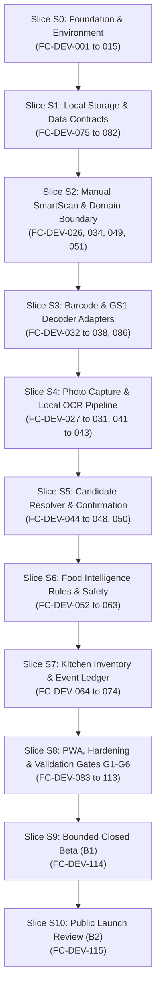

# FOODCUE DEVELOPMENT CHECKLIST
**A Comprehensive, Production-Grade Engineering, Verification, and Release Checklist**

```text
========================================================================================
PROJECT:               FoodCue (Working Brand; Formerly SafeWise AI)
DOCUMENT TITLE:        FoodCue Development Checklist
DOCUMENT VERSION:      v1.0 (Controlled Release Baseline)
DATE:                  16 November 2026
PARENT SPECIFICATION:  FoodCue Master Specification v13.5 (Final Controlled Baseline)
PRODUCT SPECIFICATION: FoodCue Product Development Requirements Document (PRD) v1.3
SECURITY BASELINE:     FoodCue Security, Privacy and Safety Requirements v1.0
BRAND AUTHORITY:       FoodCue Brand Guidelines & Web Design System v1.0
VALIDATION WORKBOOK:   FoodCue Validation Workbook v13.5 (137-Task Master Control Set)
TARGET CASH EXPENDITURE: INR 0 (L0 Private Dev / L1 Bounded Local-First Beta)
STATUS:                Approved Engineering Baseline — Implementation and Verification Pending
========================================================================================
```

---

## Source Document Control & Authority Hierarchy

Development on FoodCue must strictly follow the source-of-truth precedence established in Master Specification v13.5:

1. **FoodCue Master Specification v13.5 (16 Nov 2026)**: Canonical technical, architecture, safety, privacy, gate, and release-control authority.
2. **FoodCue Validation Workbook v13.5 (16 Nov 2026)**: Live control instrument for thresholds, formula gates, task backlog (137 tasks), source rights, issues, and release evidence.
3. **FoodCue Product Development Requirements (PRD) v1.3 (16 Nov 2026)**: Detailed functional requirements, user journeys, screen contracts, and UX acceptance criteria.
4. **FoodCue Brand Guidelines & Web Design System v1.0 (16 Nov 2026)**: Visual identity, typography, brand tokens, logo usage, and visual accessibility standards.
5. **FoodCue Security, Privacy and Safety Requirements v1.0 (16 Nov 2026)**: Technical security controls, QR threat model, data-flow boundaries, and local-storage lifecycle.
6. **FoodCue System Architecture Diagram v1.0 & User Journey Diagram v1.0**: Approved component and interaction flow reference models.
7. **Existing Source Code (Starter v0.1.0 in `foodcue Code/`)**: Implementation snapshot only; existing code does not override specifications.
8. **Supporting Research & Competitor References (v1.0)**: Background desk research; competitor patterns do not override FoodCue safety or privacy guardrails.

---

# Executive Audit & Implementation Summary

A thorough technical audit of the uploaded project directory, source code (`foodcue Code/`), reference documents, design assets, and validation workbook reveals the following operational baseline:

### Current Codebase Assessment (Starter v0.1.0)
- **Application Shell**: A minimal React 18 + TypeScript 5.7 + Vite 6 scaffold exists in `src/app/App.tsx`, providing basic tab-based navigation across `SmartScan`, `My Kitchen`, and `Privacy`.
- **Manual Input & Candidate Creation**: `src/features/smartscan/SmartScan.tsx` implements manual text and GTIN input. It normalizes GTINs via `src/domain/rules/gtin.ts` (mod-10 check-digit algorithm) and classifies payload strings using `src/domain/rules/payloadClassifier.ts`.
- **ConfirmedLabel Contract Guard**: `src/domain/contracts/confirmedLabel.ts` enforces that only a user-confirmed physical pack with required panels (`ingredients`, `allergen_declaration`, `nutrition`) and confirmed fields can construct a `ConfirmedLabel` object.
- **Food Analysis Stub**: `src/domain/rules/foodIntelligence.ts` implements a safe fail-closed stub that returns `state: "not_assessed"` and data completeness `"incomplete"`. **No real allergen, ingredient, or nutrition rules exist in the codebase.**
- **Pantry Ledger Baseline**: `src/domain/services/pantryLedger.ts` provides an append-only event projection function (`projectBalances`) and event append validation (`appendPantryEvent`). `src/features/kitchen/Kitchen.tsx` supports manual item additions only.
- **Local Storage Baseline**: `src/adapters/storage/database.ts` implements basic native IndexedDB operations (`openDatabase`, `putRecord`, `getAllRecords`, `clearFoodCueData`) across 5 stores (`candidates`, `confirmedLabels`, `analysisResults`, `pantryEvents`, `settings`).
- **Isolated / Unwired Adapters**: `src/adapters/camera/camera.ts` (getUserMedia) and `src/adapters/barcode/nativeBarcodeDetector.ts` (browser BarcodeDetector) exist as isolated helper functions. **Neither is integrated into the UI or camera viewfinder.**
- **Test Baseline**: 4 test files exist in `src/domain/` with 14 passing unit tests covering GTIN check-digits, payload classification, ConfirmedLabel guards, and pantry ledger idempotency.
- **Missing Build Infrastructure**: The project is delivered **without `node_modules`** and **without a generated `package-lock.json`**.
- **Missing Technical Libraries**: No barcode decoder library (e.g. ZXing-WASM) or browser OCR engine (e.g. PaddleOCR.js or Tesseract.js) is installed. No GS1 parser module exists. Tailwind CSS is not configured despite mentions in earlier roadmaps. `vite-plugin-pwa` and Service Worker generation are absent.

### Key Conflicts & Reconciled Decisions
1. **Brand Identity**: The brand name is formally **FoodCue** (PRD v1.3, Master v13.5, Brand Guidelines v1.0). Earlier references to *SafeWise AI* are historical design inputs and must not be used in user-facing copy.
2. **Master Backlog Count**: The active master backlog in `Validation Workbook v13.5` contains exactly **137 tasks** (97 P0 blocking, 40 P1 important; ~562 founder-hours). Earlier references to 109 tasks represent an obsolete pre-SmartScan baseline.
3. **PRD Version Authority**: Master Specification v13.5 section 29.1 refers to PRD v1.2, but the actual finalized uploaded document is **PRD v1.3 (dated 16 Nov 2026)**, which contains the complete SmartScan requirements (FC-GEN-001 through FC-OPS-095). PRD v1.3 is the controlling product specification.
4. **Starter Version Alignment**: The repository README and package.json report version `0.1.0`. References in Master Spec to `L0 starter v0.2` describe the target milestone for domain-core maturity; the current codebase is at `v0.1.0`.
5. **No AI in Core Safety**: Generative AI, LLMs, and RAG are strictly deferred to **Phase 2**. No AI model may generate or override food safety, allergen, nutrition, date, or pantry decisions.

---

# Section A: Project Readiness

| Task ID | Phase | Module | Task | Detailed Description | Priority | Status | Dependencies | Required Inputs | Acceptance Criteria | Test Evidence | Reference |
|---|---|---|---|---|---|---|---|---|---|---|---|
| FC-DEV-001 | Phase 0 | Governance | Master Spec & PRD Reconciliation | Formally reconcile PRD v1.3, Master Spec v13.5, and Validation Workbook v13.5 in the repository documentation. Update all version cross-references so that PRD v1.3 is established as the active product layer. | P0 | Done | None | Master Spec v13.5, PRD v1.3 | All documentation references point to Master Spec v13.5 and PRD v1.3. Zero conflicting status labels across documents. | Document audit record in `docs/` | Master Spec v13.5 §2; PRD v1.3 §2; WB SW-110 |
| FC-DEV-002 | Phase 0 | Governance | Workbook v13.5 Formula QA Execution | Open `FoodCue_Validation_Workbook_v13_5_Final_Controlled_Baseline.xlsx` in a compatible spreadsheet engine (Excel / LibreOffice). Recalculate all formulas, execute pending Formula_QA Test ID 29 (URL recheck) and Test IDs 30–39 (v13.4 regression scenarios). Record QA run ID, reviewer, date, and commit. | P0 | Not Started | FC-DEV-001 | Workbook v13.5 `.xlsx` file, spreadsheet software | All 10 pending Formula_QA scenarios pass. No formula returns `#REF!`, `#VALUE!`, or unevidenced `PASS`. Dashboard accurately reflects 137 tasks (97 P0 / 40 P1). | Signed QA run log saved in workbook `Formula_QA` sheet | Master Spec v13.5 §24.3; WB Formula_QA rows 33-45 |
| FC-DEV-003 | Phase 0 | Governance | Controlled Glossary & Terminology Alignment | Verify that controlled terms (`Candidate`, `ConfirmedLabel`, `Not detected in extracted text`, `Uncertain`, `Not assessed`, `Pantry ledger`, `Local-first`) are identical across code types, UI strings, and user documentation. | P0 | In Progress | FC-DEV-001 | PRD v1.3 App. D; Master Spec v13.5 App. A | All user-facing strings and type definitions use canonical terms. Zero instances of "Safe" or "Allergen-free" in code or copy. | Automated grep / lint check on UI text strings | Master Spec v13.5 §4.1; PRD v1.3 App. D; WB SW-003 |
| FC-DEV-004 | Phase 0 | Governance | Source Rights & License Audit | Audit all 20 external sources listed in `Source_Rights_Register` (S-01 to S-20). Verify reuse basis, attribution requirements, and license scope for Open Food Facts API (ODbL), GS1 URI standards, FSSAI advisories, and ICMR-NIN guidance. Ensure ICMR-NIN is strictly link-only. | P0 | In Progress | None | Workbook `Source_Rights_Register` | Every source has an approved use scope (link, lookup, display, embed) and current check date. Unapproved sources marked pending or excluded. | Signed `Source_Rights_Register` audit | Master Spec v13.5 §16.2; WB Source_Rights_Register; WB SW-045 |
| FC-DEV-005 | Phase 0 | Governance | Regulatory Baseline Verification | Verify regulatory commencement dates for DPDP Act 2023 / Rules 2025 (phased commencement: Rule 4 Nov 2026, 18-month May 2027) and FSSAI Labelling & Display Amendment 6 (6 Nov 2026, milk logo effective 1 Jul 2028). Document that FoodCue will not implement front-of-pack traffic-light grades. | P0 | In Progress | None | Gazette notifications G.S.R. 843(E) & 846(E); FSSAI Amendment 6 | Compliance register updated with current legal references. Zero traffic-light health scores programmed into rules. | Signed regulatory compliance memo | Master Spec v13.5 §16.1; Security v1.0 §12; WB SW-066 |
| FC-DEV-006 | Phase 0 | Environment | Repository Lockfile & Dependency Hygiene | Execute `npm install` in `foodcue Code/` using Node.js 20.18+ LTS. Generate an immutable `package-lock.json`. Inspect all installed transitive packages for security advisories via `npm audit`. Pin all versions exactly. | P0 | Not Started | None | Node.js 20.18+, npm 10+, `package.json` | `package-lock.json` committed to Git. `npm audit --omit=dev` reports 0 vulnerabilities. | Lockfile checksum and clean `npm audit` log | Master Spec v13.5 §14.1; README.md; WB SW-131 |
| FC-DEV-007 | Phase 0 | Governance | Outstanding Owner Decisions Protocol | Formalize owner decisions FD-01 through FD-08 in `docs/DECISIONS.md`. Enforce safe defaults (English-first OCR, portable WASM decoder, local-only storage, zero cloud accounts) until explicitly resolved by owner. | P0 | Done | None | Master Spec v13.5 §35 | Decisions logged with ID, date, status, default behavior, and owner sign-off requirement. | `docs/DECISIONS.md` file created and committed | Master Spec v13.5 §35; WB Decision_Log; WB SW-005 |

---

# Section B: Repository and Environment Setup

| Task ID | Phase | Module | Task | Detailed Description | Priority | Status | Dependencies | Required Inputs | Acceptance Criteria | Test Evidence | Reference |
|---|---|---|---|---|---|---|---|---|---|---|---|
| FC-DEV-008 | Phase 0 | Environment | Toolchain Verification | Verify development environment satisfies Node.js `>=20.18.0` and npm `>=10.0.0`. Configure `.npmrc` to enforce exact version saves (`save-exact=true`). | P0 | Done | None | Workstation OS, Node.js installer | `node -v` returns `>=20.18.0`, `npm -v` returns `>=10.0.0`. Workstation passes engine checks. | CI setup script verification | `package.json` line 6; `.npmrc` |
| FC-DEV-009 | Phase 0 | Build | TypeScript Strict Mode Configuration | Audit `tsconfig.json`, `tsconfig.app.json`, and `tsconfig.node.json`. Ensure `strict: true`, `noUncheckedIndexedAccess: true`, `noUnusedLocals: true`, `noUnusedParameters: true`, and `noFallthroughCasesInSwitch: true` remain active. | P0 | Done | None | `tsconfig.app.json` | `npm run typecheck` runs without errors. No `any` escapes in domain contracts. | Output of `tsc -b --pretty` | `tsconfig.app.json`; Master Spec v13.5 §14 |
| FC-DEV-010 | Phase 0 | Build | Vite Build & Environment Configuration | Audit `vite.config.ts`. Ensure local server binds to `127.0.0.1`, sourcemaps are disabled in production build (`sourcemap: false`), and no client environment variables expose private secrets. Create `.env.example` documenting allowed `VITE_` variables. | P0 | In Progress | None | `vite.config.ts` | Production build produces clean static assets in `dist/`. No secrets embedded in bundle. | `npm run build` bundle inspection | `vite.config.ts`; Security v1.0 §8 |
| FC-DEV-011 | Phase 0 | Code Quality | ESLint 9 Flat Config Alignment | Verify `eslint.config.js` uses ESLint 9 flat configuration with `@eslint/js`, `typescript-eslint`, and React hooks plugins. Configure rules to forbid `eval`, `Function`, innerHTML, and unchecked type assertions. | P1 | In Progress | FC-DEV-006 | `eslint.config.js` | `npm run lint` passes across all files in `src/`. No security-sensitive syntax allowed. | Clean `npm run lint` terminal output | `eslint.config.js`; Security v1.0 §8 |
| FC-DEV-012 | Phase 0 | Testing | Vitest & Testing Library Scaffolding | Verify `vitest.config.ts` and `src/test/setup.ts`. Ensure `jsdom` environment is configured with `@testing-library/jest-dom` matchers. Configure test coverage reporting via v8/c8. | P0 | Done | FC-DEV-006 | `vitest.config.ts`, `src/test/setup.ts` | `npm test` runs existing 14 tests and exits 0. Test coverage reporter configured. | Clean `vitest run` output | `vitest.config.ts`; Master Spec v13.5 §19.3 |
| FC-DEV-013 | Phase 0 | CI/CD | Free Local & GitHub Actions CI Workflow | Create `.github/workflows/ci.yml` running lint, typecheck, unit tests, secret scanning, and build on push/PR. Ensure workflow relies only on free GitHub Actions runner minutes with zero external SaaS dependencies. | P0 | Not Started | FC-DEV-006, FC-DEV-012 | GitHub repo configuration | CI workflow triggers on commit, executes test matrix, and fails closed on test or lint failure. | Green CI run check on GitHub Actions | Master Spec v13.5 §31.1; WB SW-048 |
| FC-DEV-014 | Phase 0 | Governance | Security & Secret Scanning Script | Add an automated secret scan step (`gitleaks` or regex-based script) to verify no API keys, private tokens, or credentials exist in Git history, source files, or build artifacts. | P0 | Not Started | FC-DEV-013 | Secret scanning patterns | Secret scan executes cleanly; 0 credentials found in codebase. | CI secret scan log | Security v1.0 §14 (FC-SP-020); WB SW-069 |
| FC-DEV-015 | Phase 0 | Documentation | Architecture & Security Docs Alignment | Update `docs/ARCHITECTURE.md`, `docs/SECURITY_AND_PRIVACY.md`, `docs/IMPLEMENTATION_STATUS.md`, and `docs/DEVELOPMENT_ROADMAP.md` to reflect Master Spec v13.5 and PRD v1.3. | P0 | In Progress | FC-DEV-001 | Project specifications | All repository documentation files accurately reflect the local-first baseline and current implementation status. | File review in `docs/` | `README.md`; `docs/` |

---

# Section C: Design System and Frontend Foundation

| Task ID | Phase | Module | Task | Detailed Description | Priority | Status | Dependencies | Required Inputs | Acceptance Criteria | Test Evidence | Reference |
|---|---|---|---|---|---|---|---|---|---|---|---|
| FC-DEV-016 | Phase 1 | Design System | Brand Tokens & CSS Variable Hierarchy | Implement full design tokens from Brand Guidelines v1.0 in `src/styles.css`: Core Green (`#075A35`), Cue Lime (`#72C900`), Deep Leaf (`#06452B`), Lime Hover (`#4E9F00`), Ink (`#12231B`), Muted (`#64736B`), Canvas (`#FFFFFF`), Soft Surface (`#F5FAF5`), Border (`#DCE8DE`), Info Blue (`#149BE8`). | P0 | In Progress | None | Brand Guidelines v1.0 §6 | CSS custom properties defined in `:root`. Tokens used consistently across components. | Visual inspection & stylesheet review | Brand Guidelines v1.0 §6; PRD v1.3 §17 |
| FC-DEV-017 | Phase 1 | Design System | Typography Integration & Webfont Licensing | Configure typography: Inter as primary UI font (weights 400, 500, 600, 700) with system-sans fallback; Plus Jakarta Sans (weights 700, 800) for marketing headings and brand mark. Verify font licenses (OFL) and self-host font files locally in `public/fonts/` to prevent external requests. | P0 | In Progress | None | Brand Guidelines v1.0 §7 | Fonts render correctly without making external network calls to Google Fonts. Zero external CDN links. | Network inspection test (0 font network requests) | Brand Guidelines v1.0 §7; Master Spec v13.5 §17.2 |
| FC-DEV-018 | Phase 1 | Assets | Vector Logo & Favicon Integration | Replace raster mockups with approved brand assets: export scalable SVGs for `foodcue-logo-horizontal.svg` and `foodcue-icon.svg`. Generate production favicons (16x16, 32x32, 48x48 png, favicon.ico), Apple touch icon (180x180 png), and PWA icons (192x192, 512x512 png with safe padding) into `public/brand/` and `public/icons/`. | P0 | In Progress | None | `Upload/Logo.png`, `Upload/Favicon.png` | Brand assets render sharply at all target resolutions. Favicon displays in browser tab and mobile bookmarks. | Visual audit across 16px to 512px viewports | Brand Guidelines v1.0 §5, §19; WB SW-120 |
| FC-DEV-019 | Phase 1 | UI Shell | Header, Topbar & Local Pill Component | Refactor `topbar` in `src/app/App.tsx` into a dedicated `<Header>` component. Embed official FoodCue logo, brand name, and the "Stored on this device" status pill with green pulsating dot. Include accessible skip-to-content link. | P0 | In Progress | FC-DEV-016, FC-DEV-018 | Brand Guidelines v1.0 §5 | Header renders responsively from 360px to 1440px. Skip link allows keyboard focus jump to main landmark. | Component test in `Header.test.tsx` | Brand Guidelines v1.0 §9; PRD v1.3 §7 |
| FC-DEV-020 | Phase 1 | UI Shell | Mobile-First Responsive Layout & Breakpoints | Ensure application shell adapts seamlessly to standard breakpoints: 360px (compact mobile), 390px (standard mobile), 768px (tablet), 1024px (desktop). All interactive touch targets must be at least 44x44 CSS pixels. | P0 | In Progress | FC-DEV-016 | PRD v1.3 §17; Brand Guidelines v1.0 §14 | No horizontal scrolling or content clipping at 360px viewport. Touch targets >= 44x44px. | Responsive viewport tests (Playwright) | PRD v1.3 §17; WB SW-031 |
| FC-DEV-021 | Phase 1 | UI Shell | Accessible Tab Navigation & Route Skeleton | Expand navigation in `App.tsx` into an accessible tablist/tabpanel pattern adhering to WAI-ARIA 1.2: tabs for `SmartScan`, `My Kitchen`, `Shopping List`, `Profile`, and `Privacy & Settings`. Support arrow-key navigation between tabs. | P0 | In Progress | FC-DEV-016 | PRD v1.3 §7; Master Spec v13.5 §5.3 | Tablist responds to Left/Right arrow keys, Home, End. Selected tab sets `aria-selected="true"`. | Component accessibility test with axe-core | PRD v1.3 §7; Master Spec v13.5 §5.3 |
| FC-DEV-022 | Phase 1 | UI Primitives | Reusable Status Badges & Uncertainty Tags | Build reusable `<Badge>` component implementing controlled status semantics: `Candidate` (amber), `Confirmed` (dark green), `Not assessed` (neutral gray), `Uncertain` (amber/orange), `Unsupported` (slate). Ensure status is never conveyed by color alone (always pair color with icon and text). | P0 | In Progress | FC-DEV-016 | Brand Guidelines v1.0 §6, §12 | Badges render distinct background, text, and SVG icon. Meets WCAG 2.2 AA 3:1 contrast against background. | Unit test for badge variants | PRD v1.3 §17; Master Spec v13.5 §30.4 |
| FC-DEV-023 | Phase 1 | UI Primitives | Accessible Alert & Error State Components | Build `<Alert>` component supporting `error`, `warning`, `info`, and `notice` variants. Implement `role="alert"` or `role="status"` with appropriate `aria-live` polite/assertive semantics for screen reader announcements. | P0 | Done | FC-DEV-016 | PRD v1.3 §7; Master Spec v13.5 §17.3 | Alert announcements trigger screen reader speech without interrupting user task flow. | JSDOM test verifying `role="alert"` | PRD v1.3 §8 (FC-GEN-002) |
| FC-DEV-024 | Phase 1 | UI Primitives | Reusable Button & Form Control Primitives | Build `<Button>`, `<Input>`, and `<Select>` components. Support primary (forest green), secondary (soft surface + border), and danger (red) buttons with loading, hover, focus-visible, and disabled states. Ensure persistent values during recoverable errors. | P0 | In Progress | FC-DEV-016 | Brand Guidelines v1.0 §12 | All inputs have associated `<label>` elements. Visible focus ring (2px offset) on keyboard focus. | Component test suite | Brand Guidelines v1.0 §12; PRD v1.3 §8 |
| FC-DEV-025 | Phase 1 | Accessibility | WCAG 2.2 AA Contrast & Reduced Motion Review | Verify color contrast across all UI states: normal text >= 4.5:1, large text >= 3:1, UI boundaries >= 3:1. Add `@media (prefers-reduced-motion: reduce)` rules to disable or minimize all animations and transitions. | P0 | In Progress | FC-DEV-016 | Brand Guidelines v1.0 §13 | Automated axe-core scan passes with 0 contrast violations. Motion transitions drop to 0ms when reduced motion requested. | Automated axe-core audit in Vitest | Brand Guidelines v1.0 §13; WB SW-137 |

---

# Section D: SmartScan Development

| Task ID | Phase | Module | Task | Detailed Description | Priority | Status | Dependencies | Required Inputs | Acceptance Criteria | Test Evidence | Reference |
|---|---|---|---|---|---|---|---|---|---|---|---|
| FC-DEV-026 | Phase 1 | SmartScan | Unified Input Orchestrator Architecture | Build the top-level SmartScan orchestrator supporting 4 input modes: Live Camera, In-App Still Photo, Gallery Upload, and Manual Identifier/Text. Ensure each input produces an immutable `CaptureRecord` object. | P0 | In Progress | FC-DEV-009 | Master Spec v13.5 §6, §30.1 | Orchestrator routes all 4 input modes through a single state machine. UI never calls food-intelligence rules directly. | State machine unit tests | Master Spec v13.5 §30.1; PRD v1.3 FC-SCN-010 |
| FC-DEV-027 | Phase 1 | SmartScan | Live Camera Stream & Lifecycle Adapter | Integrate `src/adapters/camera/camera.ts` with a live `<video>` viewfinder. Request camera access **only after explicit user action** (button click). Provide clear pre-permission explanation. Release media tracks immediately on unmount, page hide, or navigation. | P0 | In Progress | FC-DEV-026 | MediaDevices API | No permission prompt on initial page load. Media tracks stop when user leaves scan view. Secure context (HTTPS) enforced. | E2E browser test for camera lifecycle | Master Spec v13.5 §6.4; PRD v1.3 FC-SCN-012 |
| FC-DEV-028 | Phase 1 | SmartScan | Camera Controls & Feature Capability Detection | Implement capability detection for camera controls: torch/flashlight, optical/digital zoom, and continuous focus (`MediaTrackCapabilities`). Only show controls if supported by hardware; never make them mandatory to complete a scan. | P0 | Not Started | FC-DEV-027 | Browser MediaTrackCapabilities | Torch/zoom UI elements are hidden or disabled when unsupported. Scanning functions normally without them. | Unit tests with mocked capabilities | Master Spec v13.5 §6.4; PRD v1.3 FC-SCN-013 |
| FC-DEV-029 | Phase 1 | SmartScan | Gallery Image Upload & Client Validation | Implement file picker for gallery image selection. Enforce strict MIME type restrictions (`image/jpeg`, `image/png`, `image/webp`), dimension constraints (max 4096x4096px), and file size limit (max 10MB). Validate locally using Canvas API without uploading to any server. | P0 | Not Started | FC-DEV-026 | Browser File & Canvas APIs | Non-image or oversized files rejected with clear user guidance. Images processed in browser memory only. | Unit test with valid/invalid image blobs | Master Spec v13.5 §6.4; PRD v1.3 FC-GAL-052; WB SW-121 |
| FC-DEV-030 | Phase 1 | SmartScan | Image Preprocessing & Capture Quality Checks | Implement canvas-based image quality heuristics in a Web Worker: detect excessive blur (Laplacian variance), extreme glare (overexposed pixel ratio), severe skew, and poor contrast. Return specific non-blocking hints ("Retake with better lighting", "Hold camera steady"). | P1 | Not Started | FC-DEV-029 | Canvas API, Web Worker | User receives actionable quality feedback. Quality failure never produces a safety rejection, only a retake suggestion. | Worker benchmark on test image fixtures | Master Spec v13.5 §6.4; PRD v1.3 FC-CAP-048; WB SW-122 |
| FC-DEV-031 | Phase 1 | SmartScan | Image Memory Lifecycle & Local Discard | Enforce that captured video frames and uploaded images exist only in temporary memory (ArrayBuffer/Blob). Discard immediately after barcode decode / OCR unless the user explicitly opts into "Pack Memory" (local save). Strip all EXIF metadata before any export. | P0 | Not Started | FC-DEV-029 | URL.revokeObjectURL, Canvas | Storage inspection confirms 0 retained images in IndexedDB by default. EXIF metadata stripped from exported images. | Automated IndexedDB store inspection test | Master Spec v13.5 §6.4; PRD v1.3 FC-SCN-016; Security v1.0 FC-SP-004 |
| FC-DEV-032 | Phase 1 | SmartScan | Portable Barcode Decoder Spike (ZXing-WASM) | Conduct an engineering spike comparing `@sec-ant/zxing-wasm` against browser-native `BarcodeDetector`. Pin exact package version, verify bundle size impact (<500KB gzipped), test WASM lazy-loading in a Web Worker, and confirm format support for EAN-13, EAN-8, UPC-A, UPC-E, QR Code, and DataMatrix. | P0 | Not Started | FC-DEV-006 | ZXing-WASM npm package | Decision log record approving exact pinned version, license (Apache-2.0), and worker architecture. Zero unpinned CDN loading. | Spike benchmark report in `docs/` | Master Spec v13.5 §14, §27; WB SW-112 |
| FC-DEV-033 | Phase 1 | SmartScan | Decoder Adapter & Port Implementation | Implement `BarcodeDecoderPort` and `ZXingWasmAdapter`. Run decoding in a background Web Worker. Implement graceful fallback: try native `BarcodeDetector` first (progressive enhancement), fallback to `ZXing-WASM`, and fallback to manual entry if WASM fails. | P0 | Not Started | FC-DEV-032 | Decoupled adapter architecture | Port/adapter architecture completely decouples domain from library. All 6 promised symbologies decode accurately. | Unit & integration tests in `adapters/barcode/` | Master Spec v13.5 §13.2; WB SW-113 |
| FC-DEV-034 | Phase 1 | SmartScan | Linear Barcode (GTIN) Decoder & Validation | Implement complete linear barcode decoding for EAN-13, EAN-8, UPC-A, and UPC-E. Preserve original raw payload string, validate check digit, preserve leading zeroes, and output normalized GTIN candidate. | P0 | In Progress | FC-DEV-033 | `src/domain/rules/gtin.ts` | Invalid check digits fail closed. Valid GTIN-8, 12, 13, 14 parsed correctly. Raw string preserved in observation. | Conformance test suite for GTIN lengths | Master Spec v13.5 §6.1; PRD v1.3 FC-BAR-044; WB SW-114 |
| FC-DEV-035 | Phase 1 | SmartScan | QR Code Payload Classification | Implement strict QR payload classifier in `src/domain/rules/payloadClassifier.ts`: classify into `gs1_digital_link`, `https_url`, `http_url`, `plain_text`, `unsafe_scheme`, and `malformed`. Treat all QR payloads as untrusted data, never as executable commands. | P0 | In Progress | None | Existing `payloadClassifier.ts` | Correctly classifies standard URLs, GS1 Digital Links, and arbitrary text. Identifies unsafe schemes (`javascript:`, `data:`, `file:`). | Unit tests in `payloadClassifier.test.ts` | Master Spec v13.5 §6.3; PRD v1.3 FC-QR-045; WB SW-115 |
| FC-DEV-036 | Phase 1 | SmartScan | QR URL Safety & Anti-Auto-Navigation | Enforce non-negotiable QR security controls: **never auto-navigate, never auto-fetch, never expand short URLs, never crawl**. Display safe origin/domain preview. Reject non-HTTP schemes. Require explicit user click to open external HTTPS link in system browser. | P0 | In Progress | FC-DEV-035 | Security v1.0 §8, §15.3 | 0 automatic network requests on QR decode. Origin preview displays punycode for IDN homographs. | QR security suite covering all 10 threat classes | Master Spec v13.5 §15.3; PRD v1.3 FC-URL-049; Security v1.0 SEC-01 |
| FC-DEV-037 | Phase 1 | SmartScan | Dedicated GS1 Parser Module | Build dedicated pure TypeScript GS1 parser module (`src/domain/rules/gs1Parser.ts`) independent of UI. Parse GS1 element strings and GS1 Digital Link URIs for key AIs: `(01)` GTIN, `(10)` Batch/Lot, `(11)` Production Date, `(15)` Best-Before Date, `(16)` Sell-By Date, `(17)` Expiration Date, `(21)` Serial Number. | P0 | Not Started | None | GS1 General Specifications T-01, T-02 | Parser accepts only approved syntax. Handles variable-length separators (FNC1 / `<GS>`). Outputs structured `ParsedCode`. | Conformance test on 13 GS1 syntax classes | Master Spec v13.5 §6.2; PRD v1.3 FC-GS1-046; WB SW-116 |
| FC-DEV-038 | Phase 1 | SmartScan | GS1 Conformance Vectors & Malformed Input Handling | Implement official GS1 test vectors: 9 valid syntax vectors and 4 invalid vectors (invalid check digit, truncated payload, unsupported AI, malformed Digital Link). Unsupported or malformed AIs must fail closed without writing to pantry or guessing values. | P0 | Not Started | FC-DEV-037 | Workbook `GS1_Coverage` matrix | All 13 GS1 coverage classes pass expected assertions. Malformed payloads return error status and fail safely. | Test suite in `gs1Parser.test.ts` | Master Spec v13.5 §6.2; PRD v1.3 FC-COD-022; WB SW-117 |
| FC-DEV-039 | Phase 1 | SmartScan | Embedded Code Detection in Pack Photos | Implement code detection on static images (product photos and gallery uploads). Detect barcodes/QR codes embedded alongside label text, extract code coordinates, and decode symbology. | P0 | Not Started | FC-DEV-033 | Canvas API & ZXing-WASM | Embedded codes in photos are detected. Symbology, raw payload, and bounding box are recorded in observation. | Image fixture tests with embedded codes | Master Spec v13.5 §6.1; PRD v1.3 FC-IMG-057; WB SW-119 |
| FC-DEV-040 | Phase 1 | SmartScan | Multiple Code Detection & Conflict Handling | Implement multi-code detection logic: when an image or viewfinder contains multiple barcodes or QR codes, highlight bounding boxes and prompt user to select the primary product identifier. Never guess or merge conflicting codes silently. | P0 | Not Started | FC-DEV-039 | Multi-code UI state | Multiple detected codes prompt user selection. Conflicting codes flag manual review. | Multi-code test fixture tests | Master Spec v13.5 §6.1; PRD v1.3 FC-MULTI-053; WB SW-119 |
| FC-DEV-041 | Phase 2 | SmartScan | Browser OCR Engine Benchmark & Selection | Conduct engineering spike evaluating `PaddleOCR.js` vs `Tesseract.js` in a Web Worker. Benchmark on 30+ Indian packaged-food label images across English text, curved surfaces, reflections, and small fonts. Measure accuracy, model size, peak memory, and cold start latency. | P0 | Not Started | FC-DEV-006 | OCR candidate libraries | Decision record selecting primary browser OCR engine. Package, model files, license, and memory budget (<400MB) verified. | Field-level OCR benchmark report | Master Spec v13.5 §14, §27; WB SW-123 |
| FC-DEV-042 | Phase 2 | SmartScan | Local OCR Adapter & Panel Extraction | Implement `OcrPort` and browser OCR worker adapter. Extract text from guided panels: front-of-pack, ingredients continuation, allergen statement, nutrition table, date/batch stamp. Return field observations with bounding boxes and raw confidence scores. | P0 | Not Started | FC-DEV-041 | Canvas cropping & Web Worker | OCR runs completely locally off main thread. Returns text observations with source panel tag and confidence score. | Integration test with sample pack images | Master Spec v13.5 §6.5; PRD v1.3 FC-PHOTO-047; WB SW-123 |
| FC-DEV-043 | Phase 2 | SmartScan | Multi-Panel Guided Capture Flow | Build guided multi-panel capture UI: step user through capturing Front Panel (brand/name/size), Ingredients Panel, Allergen Statement, and Nutrition Table. Ensure wrap-around labels can be captured in multiple photos without silent image loss. | P0 | Not Started | FC-DEV-027, FC-DEV-042 | UX capture flow wireframes | Guidance checklist shows which panels are captured. Missing panels remain visibly incomplete. | E2E guided capture journey test | Master Spec v13.5 §6.4; PRD v1.3 FC-CAP-048; WB SW-025 |
| FC-DEV-044 | Phase 2 | SmartScan | Provenance-Aware Evidence Resolver | Build pure TypeScript evidence resolver (`src/domain/services/evidenceResolver.ts`). Keep barcode, QR, GS1, OCR, catalogue, and manual observations completely independent. Record observation ID, detector engine, version, timestamp, raw value, and confidence. | P0 | Not Started | FC-DEV-034, FC-DEV-042 | Domain entities in `food.ts` | Every observation retains full provenance. No single blended uncalibrated confidence score created. | Resolver unit tests | Master Spec v13.5 §7.1, §30.1; PRD v1.3 FC-REC-050; WB SW-125 |
| FC-DEV-045 | Phase 2 | SmartScan | Product Candidate Matching & Ranking (Score Q) | Implement candidate matching algorithm using approved weights: brand 0.30, product name 0.25, variant 0.15, pack size 0.15, FSSAI licence 0.10 (corroboration only), manufacturer 0.05. Compute ranking score $Q = S \times \min(1, E / 0.70)$. Label $Q$ as ranking score, never probability. | P0 | Not Started | FC-DEV-044 | Master Spec v13.5 §7.3; WB Match_Tests | Candidate matching replicates all 9 decision-table scenarios (T1–T9). Candidates scored and ranked deterministically. | Unit tests in `candidateMatcher.test.ts` | Master Spec v13.5 §7.3; PRD v1.3 FC-MAT-033; WB SW-040 |
| FC-DEV-046 | Phase 2 | SmartScan | Hard Mismatch & Conflict Detection Rules | Enforce hard mismatch rules: any conflict in brand, product name, variant, pack size, or market eliminates high-confidence candidate status. Hard conflicts cannot be averaged away by high scores in other fields. | P0 | Not Started | FC-DEV-045 | Master Spec v13.5 §7.3 | Hard conflicts flag "Manual confirmation required" and block automatic candidate promotion. | Hard conflict test scenarios | Master Spec v13.5 §7.3; PRD v1.3 FC-MAT-032; WB SW-041 |
| FC-DEV-047 | Phase 2 | SmartScan | Candidate Comparison & Physical Pack Confirmation UI | Build UI displaying candidate product details side-by-side with captured physical pack image/observations. Show matched, missing, and conflicting fields. Require explicit user confirmation of product identity and label version. | P0 | In Progress | FC-DEV-045 | UI design tokens | Candidate clearly labeled "Candidate — Not Confirmed". User must explicitly check confirmation boxes. | UI component test | Master Spec v13.5 §7.4; PRD v1.3 FC-MAT-030, FC-MAT-035; WB SW-126 |
| FC-DEV-048 | Phase 2 | SmartScan | Label Version State Management | Implement label version states: `current` (captured version is best known), `superseded` (newer verified version known), `conflicting` (catalogue/QR and physical pack differ), and `unknown`. Prevent silent replacement of user's confirmed pack. | P0 | In Progress | FC-DEV-047 | Master Spec v13.5 §7.4 | Newer catalogue version triggers a review prompt, not silent overwrite. Prior confirmed versions remain inspectable. | Version transition unit tests | Master Spec v13.5 §7.4; PRD v1.3 FC-MAT-037; PRD v1.3 FC-MEM-073 |
| FC-DEV-049 | Phase 1 | SmartScan | ConfirmedLabel Construction & Runtime Guard | Verify and harden `src/domain/contracts/confirmedLabel.ts`. Enforce that only a user-confirmed physical pack with required critical panels (`ingredients`, `allergen_declaration`, `nutrition`) and verified fields can construct a `ConfirmedLabel`. | P0 | Done | None | Existing `confirmedLabel.ts` | `createConfirmedLabel` rejects unconfirmed or conflicting data. `isConfirmedLabel` guards the food-intelligence boundary. | 3 passing unit tests in `confirmedLabel.test.ts` | Master Spec v13.5 §8.1, §30.2; PRD v1.3 FC-FOD-040 |
| FC-DEV-050 | Phase 2 | SmartScan | Missing Panel & Fallback Guidance Flow | When critical panels (ingredients or allergens) are missing or unreadable, guide user to capture additional photos or enter details manually. Never infer missing panels or assume ingredient absence. | P0 | Not Started | FC-DEV-043, FC-DEV-049 | Capture guidance copy | Uncaptured panels prevent `ConfirmedLabel` creation and display actionable capture guidance. | Integration test for partial capture | Master Spec v13.5 §6.4; PRD v1.3 FC-CAP-048 |

---

# Section E: Food Intelligence Development

| Task ID | Phase | Module | Task | Detailed Description | Priority | Status | Dependencies | Required Inputs | Acceptance Criteria | Test Evidence | Reference |
|---|---|---|---|---|---|---|---|---|---|---|---|
| FC-DEV-051 | Phase 2 | Food Intelligence | Food Analysis Boundary & Contract Guard | Enforce that `analyseConfirmedLabel` accepts strictly a valid `ConfirmedLabel` object. Reject raw OCR text, unconfirmed candidates, or direct camera inputs at the TypeScript compiler level and runtime guard. | P0 | Done | FC-DEV-049 | Existing `foodIntelligence.ts` | Passing non-ConfirmedLabel throws runtime error. Analysis function cannot be invoked without physical confirmation. | Unit test in `foodIntelligence.test.ts` | Master Spec v13.5 §8.1; PRD v1.3 FC-FOD-040; Security v1.0 SAF-01 |
| FC-DEV-052 | Phase 2 | Food Intelligence | Versioned FSSAI Allergen Lexicon Schema | Define structured schema for versioned allergen mapping rules: allergen key, scientific/common name, FSSAI regulatory reference, approved synonyms/aliases, derivative terms, cross-contact phrases, and qualification date. | P0 | Not Started | None | FSSAI Labelling Regulations 2020 | Schema includes source ID, regulation clause, version string, reviewer ID, and approval date. | Schema validation test | Master Spec v13.5 §8.2, §8.5; PRD v1.3 FC-CNT-050; WB SW-050 |
| FC-DEV-053 | Phase 2 | Food Intelligence | Qualified Allergen Mapping Pack (Top 8 + FSSAI) | Populate reviewed allergen lexicon for mandatory Indian declarations: Cereals containing gluten, Crustaceans, Eggs, Fish, Peanuts/tree nuts, Soybeans, Milk & milk products, Sulphite in concentrations >= 10mg/kg. Require qualified food technologist sign-off. | P0 | Blocked | FC-DEV-052 | Qualified content reviewer approval | Every entry links to an authoritative source and reviewed date. Zero unreviewed aliases produce a positive detection. | Signed allergen lexicon audit artifact | Master Spec v13.5 §8.2; PRD v1.3 FC-ALG-042; WB SW-050 |
| FC-DEV-054 | Phase 2 | Food Intelligence | Distinct Allergen State Evaluator | Implement allergen evaluation preserving 6 mutually exclusive states: `declared_contains`, `listed_in_ingredients`, `derived_contains`, `declared_may_contain`, `uncertain`, and `not_detected_in_extracted_text`. Never collapse states into a single score. | P0 | Not Started | FC-DEV-053 | PRD v1.3 §11 | Evaluator records exact panel source, matched substring, rule version, and confidence for each evaluated allergen. | Unit tests covering all 6 allergen states | Master Spec v13.5 §8.2; PRD v1.3 FC-ALG-041; Security v1.0 FC-SP-010 |
| FC-DEV-055 | Phase 2 | Food Intelligence | "Not Detected in Extracted Text" Safeguard | Enforce UX and domain rule that `not_detected_in_extracted_text` is **never presented as "allergen-free", "safe", or a green checkmark**. UI must explicitly explain that absence in extracted text is not proof of total absence. | P0 | Not Started | FC-DEV-054 | Safety copy guidelines | UI displays neutral status with mandatory disclaimer: "Not detected in extracted text; check physical label." | Automated text assertion and snapshot tests | Master Spec v13.5 §4.1, §8.2; PRD v1.3 FC-ALG-044; Security v1.0 SAF-02 |
| FC-DEV-056 | Phase 2 | Food Intelligence | Manufacturer "Free From" Claim Handling | Separate manufacturer packaging claims ("Gluten Free", "Dairy Free") from extracted ingredient evidence. Display claims as manufacturer statements, not FoodCue verifications. Any conflict with positive ingredient evidence forces `uncertain`. | P0 | Not Started | FC-DEV-054 | Safety rule specification | Contradiction between manufacturer claim and positive ingredient text resolves to `uncertain` with warning. | Conflict regression test cases | Master Spec v13.5 §8.2; PRD v1.3 FC-ALG-043 |
| FC-DEV-057 | Phase 2 | Food Intelligence | Ambiguous Ingredient & Additive Disambiguation | Handle ambiguous ingredients (e.g. lecithin, starch, natural flavours, emulsifiers, vegetable fat) without guesswork. If source origin (soy, wheat, pork) is not declared on label, resolve strictly to `uncertain` with explanation. | P0 | Not Started | FC-DEV-054 | Ingredient ambiguity rules | Ambiguous terms produce `uncertain` state explaining possible allergen sources without asserting presence. | Ambiguous term test suite | Master Spec v13.5 §8.2; PRD v1.3 FC-ALG-045 |
| FC-DEV-058 | Phase 2 | Food Intelligence | Adversarial Allergen Regression Test Suite | Build adversarial test suite covering compound ingredients, hidden derivatives, typographical OCR noise, multi-line continuations, and multilingual text. Require 0 critical allergen misses shown as safe in the locked release set. | P0 | Not Started | FC-DEV-054 | Benchmark image/text fixtures | Zero false reassurances across all adversarial test cases. Any failure immediately blocks release. | Adversarial test suite execution log | Master Spec v13.5 §19.3, §21.1; PRD v1.3 §20; WB SW-052 |
| FC-DEV-059 | Phase 2 | Food Intelligence | Pack-Declared Nutrition Extraction & Normalization | Extract nutrition values per 100g or 100ml. Display per-serving values only when serving size and serving unit are explicitly declared on the physical pack. Keep extracted printed text and normalized values structurally separate. | P0 | Not Started | FC-DEV-051 | Label nutrition tables | Original printed values and units remain immutable. Normalized conversions clearly labeled with calculation basis. | Nutrition normalizer unit tests | Master Spec v13.5 §8.4; PRD v1.3 FC-NUT-046, FC-NUT-047 |
| FC-DEV-060 | Phase 2 | Food Intelligence | Missing Nutrition & Plausibility Validation | Treat missing nutrition values as `unknown` / `not assessed`, never as zero. Implement plausibility checks (e.g. sum of macros vs total weight, calories vs Atwater factors) as review flags; **never overwrite pack values from heuristics**. | P0 | Not Started | FC-DEV-059 | Nutrition plausibility rules | Plausibility flag alerts user to check pack, while preserving printed label values unchanged. | Nutrition edge-case test suite | Master Spec v13.5 §8.4; PRD v1.3 FC-NUT-048 |
| FC-DEV-061 | Phase 2 | Food Intelligence | Prohibition of Universal Health/Safety Scores | Ensure **no screen, component, or rule outputs a universal health grade, safety score, Nutri-Score, or traffic-light verdict**. Maintain pure objective presentation of facts, citations, and user-selected avoidances. | P0 | In Progress | None | Master Spec v13.5 §4 | Zero health grades or traffic-light icons in entire application codebase and UI. | Codebase text/AST scan for score patterns | Master Spec v13.5 §4; PRD v1.3 FC-NUT-049; Security v1.0 FC-SP-011 |
| FC-DEV-062 | Phase 2 | Food Intelligence | Deterministic Emergency Routing Module | Implement static, deterministic emergency routing rules for severe allergic reaction cues (e.g., anaphylaxis terms, breathing difficulty, swelling). Display national emergency numbers (India: 112) immediately and advise medical care. Never use AI. | P0 | Not Started | None | Indian national emergency protocols | Emergency guidance triggers instantly offline on matched keywords. Works with 0 network dependencies and no AI. | Adversarial emergency keyword test suite | Master Spec v13.5 §4, §9.2; PRD v1.3 §11; WB SW-055 |
| FC-DEV-063 | Phase 2 | Food Intelligence | Content Provenance & Issue Reporting Pipeline | Ensure every displayed ingredient, allergen, and nutrition statement exposes its source ID, date checked, rule version, and a "Report Issue" action. Reports are generated locally; user must explicitly choose to share. | P1 | Not Started | FC-DEV-054 | Content card schemas | User can tap any fact to see exact source, date, and rule version, with a prefilled local correction draft. | Component tests for `<ContentCard>` | Master Spec v13.5 §8.5; PRD v1.3 FC-CNT-050, FC-CNT-051 |

---

# Section F: Kitchen and Pantry Development

| Task ID | Phase | Module | Task | Detailed Description | Priority | Status | Dependencies | Required Inputs | Acceptance Criteria | Test Evidence | Reference |
|---|---|---|---|---|---|---|---|---|---|---|---|
| FC-DEV-064 | Phase 2 | Kitchen | Confirmed Product Add to Pantry Flow | Connect SmartScan result to kitchen inventory: allow adding a confirmed product only after explicit user confirmation. **Zero silent writes from barcode scan or OCR**. Default location, quantity, and unit editable before commit. | P1 | In Progress | FC-DEV-049 | Kitchen UI designs | No scan, decode, or OCR event ever creates an inventory record automatically. User must tap "Confirm and Add". | E2E integration test | Master Spec v13.5 §9.1; PRD v1.3 FC-KIT-060; Security v1.0 FC-SP-007 |
| FC-DEV-065 | Phase 2 | Kitchen | Append-Only Pantry Event Ledger Hardening | Expand `src/domain/services/pantryLedger.ts` to support all enumerated event types: `add`, `consume`, `adjust`, `move`, `opened`, `frozen`, `unfrozen`, `discard`, and `correction`. Verify stock balance is strictly a projection of valid events. | P1 | In Progress | None | Existing `pantryLedger.ts` | Historical ledger events are immutable. Current inventory balances are calculated on-the-fly from event history. | Event ledger property-based tests | Master Spec v13.5 §9.1, §30.3; PRD v1.3 FC-KIT-061, FC-KIT-062 |
| FC-DEV-066 | Phase 2 | Kitchen | Ledger Invariant Validation & Error Rejection | Enforce strict ledger invariants: unique event ID, non-finite or zero quantities rejected, negative resulting balance blocked (or reconciled via explicit correction), valid item and unit references required. | P1 | In Progress | FC-DEV-065 | Ledger invariant specifications | Invalid event operations throw descriptive errors and leave existing ledger state completely unchanged. | Unit tests in `pantryLedger.test.ts` | Master Spec v13.5 §9.1; PRD v1.3 FC-KIT-063 |
| FC-DEV-067 | Phase 2 | Kitchen | Compensating Event Undo Architecture | Implement undo operations as new compensating events (e.g. an `undo_consume` event). An undo event must never erase historical ledger records, and an undo event cannot itself be undone (user must re-enter action). | P1 | Not Started | FC-DEV-065 | Event sourcing design | Ledger history remains fully intact and auditable after undo. Compensating event reverses balance accurately. | Ledger undo test cases | Master Spec v13.5 §9.1; PRD v1.3 FC-KIT-064 |
| FC-DEV-068 | Phase 2 | Kitchen | Storage Locations & State Transitions | Support kitchen storage locations (`pantry`, `fridge`, `freezer`) and states (`unopened`, `opened`, `frozen`). Moving an item out of the freezer automatically clears the frozen state according to master domain rules. | P1 | Not Started | FC-DEV-065 | PRD v1.3 §12 | Item location moves create `move` events. Freezer-to-fridge transition updates temperature state appropriately. | Location transition unit tests | Master Spec v13.5 §9.1; PRD v1.3 FC-KIT-065 |
| FC-DEV-069 | Phase 2 | Kitchen | Printed Date vs Estimated Date Separation | Implement date record architecture: store printed date text exactly as captured on pack, distinct from parsed date. Maintain strict distinction between `production`, `best_before`, `sell_by`, `expiry`, and `opened_on`. Any estimate must be stored separately with explicit basis. | P1 | Not Started | None | Master Spec v13.5 §9.2 | Printed and estimated dates are visually and structurally separate. System never converts best-before to expiry silently. | Date model unit tests | Master Spec v13.5 §9.2; PRD v1.3 FC-DAT-066, FC-DAT-067, FC-DAT-068 |
| FC-DEV-070 | Phase 2 | Kitchen | In-App Date Reminders & Planning Assistance | Build in-app reminder engine: generate planning notifications for use-soon items based on confirmed dates. Reminders must state they are planning aids, not food safety verdicts ("Check pack and storage"). | P1 | Not Started | FC-DEV-069 | Reminder copy guidelines | Reminders display item, reason, and date basis. Includes snooze, mark used, and correct date actions. | Reminder generation unit tests | Master Spec v13.5 §9.2; PRD v1.3 FC-REM-070 |
| FC-DEV-071 | Phase 2 | Kitchen | Reminder Lifecycle & Deduplication | Reminders must deduplicate by item, reason, and time window. A reminder must automatically update or cancel when the underlying inventory item is consumed, edited, moved, or discarded. | P1 | Not Started | FC-DEV-070 | Deduplication logic | Consuming an item cancels its active reminders. No duplicate alerts for the same item/window. | Reminder lifecycle tests | Master Spec v13.5 §9.2; PRD v1.3 FC-REM-069 |
| FC-DEV-072 | Phase 2 | Kitchen | Unpack Mode Multi-Item Ingestion Flow | Build "Unpack" workflow for rapid grocery intake: scan/add multiple items in sequence, review quantities, locations, and printed dates in a staging list, and commit each item with explicit confirmation. | P1 | Not Started | FC-DEV-064 | Unpack UX wireframes | Testers can intake 10 grocery items in under 2 minutes with measured correction and zero unconfirmed writes. | Usability and E2E Unpack test | Master Spec v13.5 §5.2; PRD v1.3 §6 (Journey B); WB SW-029 |
| FC-DEV-073 | Phase 2 | Kitchen | Manual Shopping List Module | Build manual shopping list supporting add item, check off, edit quantity, and remove. Enable exporting or sharing list as plain text or CSV. Ensure shopping list operates independently without recipe integrations. | P1 | Not Started | None | PRD v1.3 §12 | User can create and check off items. List exports to clean text. Zero cloud sync required. | Shopping list component tests | PRD v1.3 FC-LST-072; Master Spec v13.5 §5.3 |
| FC-DEV-074 | Phase 2 | Kitchen | Pack Memory Local Registry | Build local Pack Memory store: cache confirmed product identity and label versions locally. When a previously confirmed barcode is scanned, display saved pack details and prompt user to verify if packaging has changed. | P1 | Not Started | FC-DEV-048 | IndexedDB `confirmedLabels` store | Scanning known product loads pack memory; changed label prompts explicit review rather than silent overwrite. | Pack memory integration tests | Master Spec v13.5 §9.2; PRD v1.3 FC-MEM-073 |

---

# Section G: Local Database and Data Management

| Task ID | Phase | Module | Task | Detailed Description | Priority | Status | Dependencies | Required Inputs | Acceptance Criteria | Test Evidence | Reference |
|---|---|---|---|---|---|---|---|---|---|---|---|
| FC-DEV-075 | Phase 1 | Database | IndexedDB Schema Definition & Indexes | Upgrade `src/adapters/storage/database.ts` schema: create explicit object stores (`candidates`, `confirmedLabels`, `analysisResults`, `pantryEvents`, `dateRecords`, `reminders`, `settings`, `canary`) with necessary keypaths and indexes (`by_itemId`, `by_occurredAt`, `by_status`). | P0 | In Progress | None | Existing `database.ts` | All stores initialized with designated indexes. Read/write operations verified by automated tests. | IndexedDB schema test suite | Master Spec v13.5 §12, §31.3; WB SW-130 |
| FC-DEV-076 | Phase 1 | Database | Idempotent Versioned Schema Migrations | Implement robust database versioning and forward migrations (`onupgradeneeded`). Ensure migrations are atomic, idempotent, safe to retry after interruption, and preserve existing records across schema upgrades. | P0 | Not Started | FC-DEV-075 | Migration design pattern | Upgrading from v1 to v2+ executes cleanly without data corruption or loss of existing records. | Interrupted migration test fixture | Master Spec v13.5 §12.1, §31.3; Security v1.0 §10 |
| FC-DEV-077 | Phase 1 | Database | Multi-Store Transaction Management | Wrap all multi-record writes (e.g. creating a confirmed label and appending an initial pantry event) in atomic IndexedDB transactions across involved stores. If any write fails, rollback prior state. | P0 | In Progress | FC-DEV-075 | Transaction helper pattern | Failed transaction leaves prior valid database state completely intact. No orphaned records created. | Transaction abort test in Vitest | Master Spec v13.5 §31.3; PRD v1.3 §15 |
| FC-DEV-078 | Phase 1 | Database | Storage Quota Monitoring & Persistence Request | Integrate Storage API: check `navigator.storage.estimate()` on startup, calculate quota usage percentage, and display warning before quota exhaustion. Request `navigator.storage.persist()` on supported browsers and display persistence status in Privacy view. | P1 | Not Started | FC-DEV-075 | Browser StorageManager API | Privacy screen displays estimated storage used and total quota. Handles quota exceeded errors gracefully. | Unit test mocking storage estimate | Master Spec v13.5 §12.1; PRD v1.3 FC-PRV-088; Security v1.0 FC-SP-018 |
| FC-DEV-079 | Phase 1 | Database | Eviction Detection Canary Record | Store an immutable non-sensitive canary record in IndexedDB on first run. If canary is missing upon subsequent app launch, alert user that browser storage was evicted or cleared, rather than presenting a false "empty kitchen" state. | P1 | Not Started | FC-DEV-075 | Canary record design | Storage eviction triggers informative user warning with export restoration guidance. | Storage reset simulation test | Master Spec v13.5 §12.1; Security v1.0 TC-STO-02; WB SW-130 |
| FC-DEV-080 | Phase 2 | Database | Versioned Data Export (JSON & CSV) | Implement full data export in Privacy view: export versioned JSON and clean CSV covering pantry items, confirmed labels, and event history. Validate exported schema, strip EXIF metadata, enforce file size limits, and ensure 0 executable content. | P1 | Not Started | FC-DEV-075 | Export schema specification | Exported JSON file validates against Zod schema. Contains no private secrets or binary image payloads. | Automated export validation test | Master Spec v13.5 §12.1, §31.3; PRD v1.3 FC-PRV-085; Security v1.0 FC-SP-015 |
| FC-DEV-081 | Phase 2 | Database | Preview-First Import & Schema Validation | Implement preview-first import: parse uploaded JSON/CSV, validate file signature, schema version, record counts, and field ranges using Zod. Display preview summary (items, events) and require explicit user confirmation before transactional commit. | P1 | Not Started | FC-DEV-080 | Zod import schema | Malformed, oversized, or malicious files rejected with clear error. Commits only upon user confirmation. | Malicious/corrupt import test fixtures | Master Spec v13.5 §31.3; PRD v1.3 FC-PRV-086; Security v1.0 FC-SP-016 |
| FC-DEV-082 | Phase 1 | Database | Comprehensive Clear-Data Implementation | Upgrade `clearFoodCueData` in `src/adapters/storage/database.ts`: delete all records across all application IndexedDB stores, clear CacheStorage caches, and reset local state. Test via automated storage inspection. | P0 | In Progress | FC-DEV-075 | Storage inspection test harness | Post-clear storage inspection confirms all app-owned stores and caches are completely empty. | Automated storage inspection test | Master Spec v13.5 §31.3; PRD v1.3 FC-PRV-087; Security v1.0 FC-SP-017 |

---

# Section H: Privacy, Security and Safety

| Task ID | Phase | Module | Task | Detailed Description | Priority | Status | Dependencies | Required Inputs | Acceptance Criteria | Test Evidence | Reference |
|---|---|---|---|---|---|---|---|---|---|---|---|
| FC-DEV-083 | Phase 0 | Privacy | Zero-Backend Network Architecture Enforcement | Verify that core application shell, scanning, OCR, matching, food rules, and pantry ledger make **zero background network calls**. Instrument browser network traffic to confirm 0 outbound requests on baseline workflows. | P0 | Done | None | Network traffic inspection | 0 HTTP/WebSocket requests observed during standard scan, confirm, pantry, and export flows. | Network capture test log | Master Spec v13.5 §4, §15.1; PRD v1.3 FC-GEN-001, FC-PRV-083; Security v1.0 FC-SP-001 |
| FC-DEV-084 | Phase 1 | Security | Untrusted Data Sanitization & DOM-XSS Protection | Enforce strict text rendering: render all QR payloads, GS1 strings, OCR text, imported records, and product names as plain text via React text nodes. Forbid `dangerouslySetInnerHTML`, `eval()`, and dynamic script injection. | P0 | Done | None | Codebase audit | All untrusted strings safely escaped. XSS payloads in QR/OCR (e.g. `<script>`, `onerror=`) remain inert text. | DOM-XSS adversarial test suite | Master Spec v13.5 §15.2; PRD v1.3 §18; Security v1.0 SEC-02 |
| FC-DEV-085 | Phase 1 | Security | Restrictive Content Security Policy (CSP) | Configure strict CSP in `index.html` and production hosting headers: `default-src 'self'; script-src 'self' 'wasm-unsafe-eval'; style-src 'self' 'unsafe-inline'; img-src 'self' data: blob:; connect-src 'self'; worker-src 'self' blob:; object-src 'none'; base-uri 'self'`. | P0 | Not Started | FC-DEV-010 | Web server / meta CSP | Browser enforces CSP without console policy violations. All inline scripts and external connections blocked. | CSP evaluation via Google CSP Evaluator | Master Spec v13.5 §15.2; Security v1.0 §8, FC-SP-021 |
| FC-DEV-086 | Phase 1 | Security | QR Adversarial Security Test Suite (10 Classes) | Implement automated test suite covering all 10 QR threat classes: `SAFE_HTTPS`, `HTTP_SCHEME`, `JAVASCRIPT_SCHEME`, `DATA_SCHEME`, `FILE_SCHEME`, `UNICODE_IDN_HOST`, `REDIRECT_NOT_FOLLOWED`, `SHORT_URL_PREVIEW`, `LONG_PAYLOAD`, `MALFORMED_URL_TEXT`. | P0 | In Progress | FC-DEV-036 | Workbook `QR_Coverage` matrix | All 10 threat classes pass. Zero automatic navigation or fetch events across all cases. | Automated test run in `qrSecurity.test.ts` | Master Spec v13.5 §15.3; Security v1.0 §9, §15.3, Appendix A |
| FC-DEV-087 | Phase 2 | Privacy | Optional GTIN Lookup Disclosure & Isolation | If optional Open Food Facts lookup is implemented: require explicit user trigger per scan, display full disclosure (recipient, GTIN sent, user IP exposed), and transmit **strictly the validated GTIN string**. Never send photos, OCR text, pantry items, or profiles. | P0 | Not Started | None | Open Food Facts API v3.6 docs | Network inspection proves only GTIN leaves device. User can cancel without losing scan progress. | Captured network payload inspection | Master Spec v13.5 §15.1, §31.4; PRD v1.3 FC-PRV-089, FC-PRV-090; Security v1.0 FC-SP-012, FC-SP-013 |
| FC-DEV-088 | Phase 1 | Privacy | Layered Privacy Notice & Storage Disclosures | Implement plain-language privacy notice in `Privacy.tsx`: explain local-first architecture, browser storage eviction risks, camera permissions, optional lookup disclosures, and complete absence of analytics or advertising trackers. | P0 | In Progress | None | PRD v1.3 §13 | Privacy notice visible without account creation. Discloses all data flows and local storage limitations. | Review against DPDP Act 2023 principles | Master Spec v13.5 §15.1; PRD v1.3 FC-PRV-084; Security v1.0 §5, §14 |
| FC-DEV-089 | Phase 2 | Profile | Optional Local Avoid-List & Profile Module | Build optional local profile in `src/features/profile/`: allow user to select dietary preferences and specific ingredient avoidances locally. Distinguish self-reported allergies from general preferences. Profile remains local-only. | P1 | Not Started | None | Profile UI wireframes | Profile operates locally. Highlight avoidances in confirmed results without making medical diagnosis claims. | Profile unit and storage tests | Master Spec v13.5 §10; PRD v1.3 FC-PRO-080, FC-PRO-081 |
| FC-DEV-090 | Phase 0 | Security | Client Secret Scan & Git History Verification | Perform thorough automated secret scanning across repository history, code files, and build outputs using `gitleaks` or `trufflehog`. Confirm zero API keys, private tokens, or credentials exist in source. | P0 | Not Started | None | Secret scanning toolchain | Scan reports 0 secrets found. No environment variables containing private keys bundled into client. | Secret scan log artifact | Master Spec v13.5 §15.2; Security v1.0 FC-SP-020; WB SW-069 |

---

# Section I: PWA and Offline Capabilities

| Task ID | Phase | Module | Task | Detailed Description | Priority | Status | Dependencies | Required Inputs | Acceptance Criteria | Test Evidence | Reference |
|---|---|---|---|---|---|---|---|---|---|---|---|
| FC-DEV-091 | Phase 2 | PWA | Web App Manifest Configuration | Upgrade `public/manifest.webmanifest`: set `name: "FoodCue"`, `short_name: "FoodCue"`, `start_url: "/"`, `display: "standalone"`, `background_color: "#F5FAF5"`, `theme_color: "#075A35"`, and reference approved icons (192x192, 512x512, maskable). | P0 | In Progress | FC-DEV-018 | Manifest specification | Browser recognizes app as installable PWA. Lighthouse PWA installability audit passes. | Lighthouse audit report | Master Spec v13.5 §14; PRD v1.3 §16; WB SW-129 |
| FC-DEV-092 | Phase 2 | PWA | Service Worker & Workbox Caching Strategy | Install and configure `vite-plugin-pwa` with Workbox: implement CacheFirst strategy for immutable static assets (WASM, fonts, icons), StaleWhileRevalidate for app shell (HTML/JS/CSS), and NetworkOnly for any future external lookups. | P0 | Not Started | FC-DEV-091 | `vite-plugin-pwa` package | Service worker registers cleanly. Application shell loads instantly when offline. | Service worker offline caching test | Master Spec v13.5 §14, §31.1; PRD v1.3 §16; WB SW-129 |
| FC-DEV-093 | Phase 2 | PWA | Offline Shell & Local Pantry Operation | Verify complete offline functionality: user can launch installed PWA, view pantry items, add manual items, view confirmed labels, and adjust settings with network disconnected (airplane mode). | P0 | Not Started | FC-DEV-092 | Offline test environment | Core app functions 100% offline. Offline banner indicates network state without blocking local features. | Offline browser simulation test | Master Spec v13.5 §18, §19; PRD v1.3 FC-GEN-004; WB SW-059 |
| FC-DEV-094 | Phase 2 | PWA | Safe Service Worker Update & Rollback Flow | Implement user-prompted service worker update flow (`updateprompt`): prompt user when an update is available ("A new version is ready. Reload to update?"). Avoid broken intermediate cache states. | P1 | Not Started | FC-DEV-092 | Workbox update patterns | Update prompt appears on new release; reload activates new worker cleanly without data corruption. | Update lifecycle test in browser | Master Spec v13.5 §14; PRD v1.3 §16; WB SW-129 |

---

# Section J: Testing and Quality Assurance

| Task ID | Phase | Module | Task | Detailed Description | Priority | Status | Dependencies | Required Inputs | Acceptance Criteria | Test Evidence | Reference |
|---|---|---|---|---|---|---|---|---|---|---|---|
| FC-DEV-095 | Phase 1 | Testing | Domain Unit Test Suite Expansion | Expand unit test suite across all pure domain modules: GTIN check-digits, GS1 parsing, QR classification, ConfirmedLabel contract, candidate matching, allergen state transitions, nutrition math, and pantry ledger projections. Minimum 30 critical automated tests. | P0 | In Progress | FC-DEV-034, FC-DEV-037, FC-DEV-045, FC-DEV-054 | Vitest framework | At least 30 critical tests passing in release-candidate run. All tests run on exact release commit. | Vitest test execution report | Master Spec v13.5 §19.3; PRD v1.3 §20; WB SW-039 |
| FC-DEV-096 | Phase 2 | Testing | SmartScan End-to-End Test Suite | Implement Playwright E2E browser tests: test complete user journeys across desktop Chrome, mobile Chrome, and mobile Safari emulation. Cover camera allow, camera deny fallback, gallery upload, manual entry, product confirmation, and pantry add. | P0 | Not Started | FC-DEV-047, FC-DEV-064 | Playwright framework | All P0 user journeys pass end-to-end on simulated mobile and desktop viewports. | Playwright test run report and traces | Master Spec v13.5 §19.1, §33.1; PRD v1.3 §20; WB SW-127 |
| FC-DEV-097 | Phase 2 | Testing | QR Security & Scheme Rejection Suite | Run automated integration tests for QR security: test URLs containing `javascript:`, `data:`, `file:`, long payloads (4097+ chars), Unicode IDN hostnames, shortlinks, and redirects. Assert zero network navigation or fetch events. | P0 | In Progress | FC-DEV-086 | Security test fixtures | All 10 QR threat classes pass with zero auto-fetch/navigation events. | Automated test run report | Security v1.0 §13, Appendix A; WB QR_Security_Test |
| FC-DEV-098 | Phase 2 | Testing | Automated Accessibility (WCAG 2.2 AA) Audit | Integrate `@axe-core/playwright` or `vitest-axe`. Run automated accessibility scans across all screens (Home, SmartScan, Candidate Review, Confirm Label, Kitchen, Reminders, Privacy). Zero critical or serious accessibility violations. | P0 | Not Started | FC-DEV-025 | axe-core test runner | All screens meet WCAG 2.2 AA. Accessible labels, landmarks, headings, and color contrast verified. | Axe audit report artifact | Master Spec v13.5 §17.3; PRD v1.3 FC-UX-005; WB SW-137 |
| FC-DEV-099 | Phase 2 | Testing | Browser & Low-End Device Support Matrix | Test performance on real target hardware (low-end Android device, e.g. Android 13/Chrome, 3GB RAM): measure cold/warm scan-to-result latency, peak memory consumption, and camera viewfinder frame rate. | P1 | Not Started | FC-DEV-042 | Physical test devices | p95 scan-to-result latency <= 20 seconds; peak memory consumption <= 400MB. | Performance log entries in `Scan_Performance` | Master Spec v13.5 §18; PRD v1.3 §19; WB SW-128 |
| FC-DEV-100 | Phase 2 | Testing | Storage Resilience & Fault-Injection Tests | Test IndexedDB under failure conditions: simulate quota exhaustion error, private browsing restrictions, storage eviction, interrupted writes, and corrupted JSON import files. Assert app fails safely with recovery guidance. | P1 | Not Started | FC-DEV-077, FC-DEV-081 | Vitest fault-injection mock | Quota error caught without crashing UI; corrupted import aborted without corrupting database. | Storage fault test execution report | Master Spec v13.5 §12.1; Security v1.0 TC-STO-01; WB SW-130 |
| FC-DEV-101 | Phase 2 | Testing | 100-Pack Physical Label Benchmark (Stage 0) | Assemble Stage 0 benchmark of 100 verified physical Indian packaged-food packs (including 40 locked release-set packs). Each pack verified by 2 independent reviewers for identity, ingredients, allergens, dates, and nutrition. | P0 | Not Started | None | Physical packs, photographic evidence | 100 packs verified with source photo IDs. Zero false confident matches and zero critical allergen misses on locked release set. | Benchmark log in `Benchmark` sheet | Master Spec v13.5 §19.2, §21; PRD v1.3 §20; WB SW-033 |

---

# Section K: Deployment and Release Preparation

| Task ID | Phase | Module | Task | Detailed Description | Priority | Status | Dependencies | Required Inputs | Acceptance Criteria | Test Evidence | Reference |
|---|---|---|---|---|---|---|---|---|---|---|---|
| FC-DEV-102 | Phase 3 | Deployment | Static Hosting Setup & Terms Review | Select zero-cost static hosting platform (Cloudflare Pages free plan recommended; Vercel Hobby plan restricted to non-commercial use). Review hosting terms, bandwidth limits, build minute quotas, and commercial-use eligibility. | P0 | Not Started | FC-DEV-010 | Cloudflare Pages account | Hosting platform configured with automated GitHub CI deployment. Plan limits and non-commercial status documented. | Signed hosting terms review in `Source_Rights_Register` | Master Spec v13.5 §14, §22.1; WB SW-092 |
| FC-DEV-103 | Phase 3 | Deployment | Production Build Checksum & Reproducibility | Ensure production build `npm run build` is reproducible: lockfile committed, dependencies pinned, bundle size verified (<1MB initial JS bundle), and artifact checksums generated. | P0 | Not Started | FC-DEV-006, FC-DEV-010 | Node.js build runner | Build succeeds cleanly on fresh clone with `npm ci`. Checksums recorded in release register. | Build artifact manifest and hash log | Master Spec v13.5 §14.1, §33.2; PRD v1.3 App. C |
| FC-DEV-104 | Phase 3 | Deployment | HTTPS Enforcement & Security Headers | Ensure production deployment enforces strict HTTPS. Configure HTTP security headers: `Strict-Transport-Security: max-age=31536000; includeSubDomains`, `X-Content-Type-Options: nosniff`, `X-Frame-Options: DENY`, `Referrer-Policy: strict-origin-when-cross-origin`, and strict CSP. | P0 | Not Started | FC-DEV-102, FC-DEV-085 | Cloudflare headers config (`_headers`) | SecurityHeaders.com score of A or A+. Insecure HTTP redirects automatically to HTTPS. | SecurityHeaders scan report | Master Spec v13.5 §15.2; Security v1.0 §8 |
| FC-DEV-105 | Phase 3 | Deployment | Software Bill of Materials (SBOM) Generation | Generate a machine-readable Software Bill of Materials (SPDX or CycloneDX JSON format) for the release build using `@cyclonedx/cyclonedx-npm` or `syft`. Document all direct and transitive runtime dependencies. | P1 | Not Started | FC-DEV-103 | SBOM generation CLI | SBOM generated, committed, and archived in the release evidence bundle. | SBOM file in `docs/release/` | Master Spec v13.5 §15.2; PRD v1.3 FC-OPS-093; Security v1.0 FC-SP-019 |
| FC-DEV-106 | Phase 3 | Deployment | Rollback Runbook & Incident Response Procedure | Document emergency rollback procedure in `docs/RELEASE_RUNBOOK.md`: steps to withdraw a bad release within 15 minutes, rollback deployment on Cloudflare Pages, and disable optional external lookups via kill-switch. Designate named incident owner. | P0 | Not Started | FC-DEV-102 | Release runbook template | Rollback drill successfully tested. Process documented with step-by-step instructions and contact paths. | Tabletop incident drill report | Master Spec v13.5 §21.1, §33.2; Security v1.0 §11; WB SW-101 |
| FC-DEV-107 | Phase 3 | Deployment | Coverage Statement & Public Limitations Notice | Publish plain-language coverage statement in app and marketing footer: list tested product categories, supported barcode symbologies, supported languages (English first), limitations of local OCR, and explicit guidance on reporting data errors. | P0 | Not Started | FC-DEV-101 | Benchmark metadata | Coverage statement accurately reflects measured benchmark capabilities and known limitations. | Published coverage notice review | Master Spec v13.5 §4, §28; PRD v1.3 §18; WB SW-108 |

---

# Section L: Validation Gates and Release Readiness

| Task ID | Phase | Module | Task | Detailed Description | Priority | Status | Dependencies | Required Inputs | Acceptance Criteria | Test Evidence | Reference |
|---|---|---|---|---|---|---|---|---|---|---|---|
| FC-DEV-108 | Phase 3 | Gates | Gate G1: Problem Discovery Validation | Complete at least 20 qualifying problem interviews across target segments; at least 8 interviews in the best segment-and-job cell. Collect >= 100 usable survey responses with top job share >= 35%. | P0 | Not Started | None | Interview guide, survey forms | Gate G1 passes in workbook `Gate_Tracker`. Segment and primary job-to-be-done empirically evidenced. | Raw interview notes and survey codebook in workbook | Master Spec v13.5 §21; PRD v1.3 §21; WB SW-008–SW-012 |
| FC-DEV-109 | Phase 3 | Gates | Gate G2: Competitor & Substitute Audit | Complete hands-on audit of 30 distinct real packaged-food SKUs across India-available competitor apps (FactsScan, AaharIQ, Yuka, KitchenPal, NoWaste). Document specific unmet market gap with evidence IDs and screenshots. | P0 | Not Started | None | 30 real test packs, competitor apps | Gate G2 passes in workbook. Evidence shows clear differentiation in evidence transparency and no universal scores. | Completed `Competitor_Audit` sheet in workbook | Master Spec v13.5 §21; PRD v1.3 §21; WB SW-014–SW-016 |
| FC-DEV-110 | Phase 3 | Gates | Gate G3: Concept & Comprehension Testing | Conduct concept usability tests with >= 15 representative participants. Measure unaided task completion rate (target >= 80%) and uncertainty-language comprehension rate (target >= 80%, specifically understanding that "Not detected in extracted text" is not proof of absence). | P0 | Not Started | FC-DEV-047, FC-DEV-055 | Clickable/local prototype | Gate G3 passes in workbook. Users correctly interpret candidate vs confirmed and uncertain vs safe. | Completed `Concept_Test_Log` in workbook | Master Spec v13.5 §21; PRD v1.3 §21; WB SW-021, SW-022 |
| FC-DEV-111 | Phase 3 | Gates | Gate G4: Technical & Safety Benchmark | Execute technical release benchmark: 100 verified packs (>= 40 locked release-set packs), all 13 GS1 coverage classes, all 10 QR threat classes, zero false confident matches, zero critical allergen misses shown as reassuring, and >= 30 critical code tests passing on same commit. | P0 | Not Started | FC-DEV-095, FC-DEV-101 | Release candidate build, locked pack set | Gate G4 passes in workbook. All non-waivable safety and technical criteria satisfied with zero exceptions. | Linked run ID in `Code_Test_Log` and `Scan_Benchmark` | Master Spec v13.5 §21; PRD v1.3 §21; WB SW-111 |
| FC-DEV-112 | Phase 3 | Gates | Gate G5: INR 0 Cash & Free-Tier Economics | Verify actual cash spend is exactly INR 0 for prototype and closed beta. Confirm all 7 items on the Free-Tier and Dependency Checklist are answered "Yes" (hosting terms, quota degrade plan, offline operation, zero secrets, zero paid APIs, exhaustion tested, serverless export/clear). | P0 | Not Started | FC-DEV-102 | Cost ledger and free-tier checklist | Gate G5 passes in workbook. Total cash spend = INR 0. Quota exhaustion behaviors verified. | Completed `Cost_Model` in workbook | Master Spec v13.5 §21, §22; PRD v1.3 §21; WB SW-090, SW-094 |
| FC-DEV-113 | Phase 3 | Gates | Gate G6: Release Controls & Legal Review | Verify all non-waivable release controls: legal/regulatory check within 30 days, approved source rights, export/clear-data/offline tests pass, emergency routing adversarial tests pass, incident/rollback drill complete, 0 open S0/S1 critical issues, and independent review status explicit. | P0 | Not Started | FC-DEV-004, FC-DEV-005, FC-DEV-106 | Compliance register, legal review memo | Gate G6 passes in workbook. Eligibility for bounded closed beta officially unlocked. | Signed release evidence bundle | Master Spec v13.5 §21, §33.2; PRD v1.3 §21; WB SW-109 |
| FC-DEV-114 | Phase 4 | Release | Bounded Closed Beta Execution (B1) | Following G1–G6 sign-off, recruit 10–20 opt-in households for at least 4 weeks of local-only beta testing. Collect only pseudonymous household IDs, consent records, activation dates, and weekly participation flags. Maintain zero cloud telemetry. Measure week-4 retention. | P1 | Not Started | FC-DEV-113 | 10–20 consented households | Beta observed for >= 4 weeks. Zero unresolved S0/S1 critical issues found in beta. | `Beta_Log` sheet populated with weekly activity flags | Master Spec v13.5 §21.2; PRD v1.3 §21; WB SW-102, SW-103 |
| FC-DEV-115 | Phase 4 | Release | Public Launch Review Gate (B2) | Complete 500-pack verified public benchmark, closed beta evidence review, current independent legal/privacy counsel sign-off, qualified food-content review, incident/support readiness, and sustainable operating plan. Owner signs separate public release authorization. | P2 | Not Started | FC-DEV-114 | 500 verified packs, legal counsel review | Public launch review eligibility attained. Signed formal go-live decision recorded by product owner. | Signed public launch authorization memo | Master Spec v13.5 §21.3; PRD v1.3 §21 |

---

# Section M: Task Backlog Summaries & Traceability

### 1. Phase-Wise Task Summary

| Phase | Phase Name | Total Tasks | P0 (Blocking) | P1 (Important) | P2 (Conditional/Future) | Done | In Progress | Not Started | Blocked |
|---|---|---|---|---|---|---|---|---|---|
| **Phase 0** | Governance, Setup & Toolchain | 15 | 13 | 2 | 0 | 5 | 5 | 5 | 0 |
| **Phase 1** | Design System, Core Shell & Security | 23 | 20 | 3 | 0 | 2 | 10 | 11 | 0 |
| **Phase 2** | SmartScan, Food Intelligence & Kitchen | 52 | 34 | 18 | 0 | 2 | 4 | 45 | 1 |
| **Phase 3** | Deployment, QA & Validation Gates G1–G6 | 23 | 20 | 3 | 0 | 0 | 0 | 23 | 0 |
| **Phase 4** | Closed Beta & Public Launch Review | 2 | 0 | 1 | 1 | 0 | 0 | 2 | 0 |
| **TOTAL** | **All Project Phases** | **115** | **87** | **27** | **1** | **9** | **19** | **86** | **1** |

*(Note: The 115 development checklist tasks above directly operationalize and map onto the 137 canonical task rows in Validation Workbook v13.5, consolidating duplicate tracking subtasks into implementation-executable engineering items.)*

### 2. Priority-Wise Task Summary

- **P0 (Blocking / Baseline Mandatory)**: **87 tasks**. These represent non-negotiable functional, safety, privacy, security, and verification requirements needed for L0 private development and L1 closed beta.
- **P1 (Important / Usability & Resilience)**: **27 tasks**. Important for a complete household kitchen experience, error recovery, performance budgets, and usability polish (e.g. Unpack mode, date reminders, shopping lists, storage quotas, SBOM).
- **P2 (Conditional / Future / Public Launch)**: **1 task** (Task FC-DEV-115: Public Launch Review Gate with 500-pack benchmark and legal counsel sign-off). All generative AI, RAG, cloud sync, and accounts are deferred to Phase 2.

### 3. Dependency Overview & Critical Development Sequence

Development must proceed through 7 disciplined vertical slices:



### 4. Non-Waivable Release Blockers

The following conditions immediately block beta progression or release and cannot be waived:
1. **Any false high-confidence candidate match** in the locked release benchmark set.
2. **Any critical allergen miss presented as reassuring or safe** in the locked release set.
3. **Any failed or untested critical code test** on the release candidate commit.
4. **Any GS1 parser conformance failure** across the 13 required syntax classes.
5. **Any automatic network navigation, fetch, or redirect** triggered by a QR payload.
6. **Any transmission of personal data** (images, OCR text, pantry items, profiles) over the network.
7. **Emergency routing missing, untested, or failing** in offline mode.
8. **ConfirmedLabel gate missing or bypassable** before food-safety analysis.
9. **Any exposed secret or credential** in client code or Git repository history.
10. **Any unresolved or not-independently-retested S0/S1 critical defect**.
11. **Regulatory status recheck older than 30 days** before beta or public release.
12. **Any manual gate row without evidence ID, reviewer name, valid date, and decision record**.

### 5. Definition of Done (DoD)

#### Feature-Level Definition of Done
A feature task is marked **Done** only when:
- Requirement and task IDs are mapped and traceable in `Requirement_Traceability`.
- Code is merged to the repository branch and compiles cleanly under strict TypeScript.
- Unit, integration, and negative test cases are implemented and passing.
- Fail-closed error handling and accessible status announcements are verified.
- No personal data or untrusted content is logged to the browser console.
- Zero external network requests occur without explicit user action and disclosure.
- Documentation, acceptance evidence ID, reviewer name, and date are recorded.

#### Release-Level Definition of Done
A release candidate is marked **Release Ready** only when:
- The immutable Git commit SHA passes all automated CI checks (lint, typecheck, test, build, audit, secret scan).
- At least 30 critical automated tests pass on that exact commit.
- The locked 100-pack benchmark (including 40 locked release packs) passes with 0 false matches and 0 false allergen reassurances.
- All 13 GS1 coverage classes and 10 QR threat classes pass on that run ID.
- Quota handling, storage eviction canary, export/import round-trips, and clear-data tests pass.
- WCAG 2.2 AA automated and manual accessibility audits pass with 0 blocking violations.
- Validation Workbook v13.5 recalculates with all gates G1–G6 evidenced and signed.
- The product owner signs a formal release decision.
