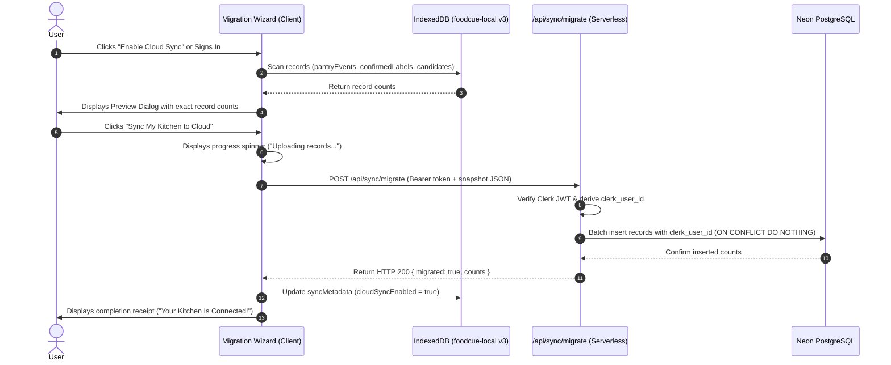

# FoodCue Local-to-Cloud Data Migration Architecture

```text
========================================================================================
MODULE:                Local-to-Cloud Migration Wizard
SPECIFICATION:         FoodCue PRD v1.3 §6.3 & Master Specification v13.5 §12
PRIVACY BASELINE:      Zero-Forced-Upload (Strict Explicit User Consent)
DATA INTEGRITY:        Atomic Batch Commit with Zero Local Data Deletion
========================================================================================
```

---

## 1. Overview & Core Philosophy

FoodCue adheres strictly to the principle of **Local-First Primacy with Opt-In Cloud Synchronization**. 

Under no circumstances does FoodCue silently or automatically upload an anonymous user's local pantry inventory or scanned records simply because they signed in. Instead, cloud onboarding follows an explicit, transparent migration workflow powered by the **Migration Wizard** (`src/features/sync/MigrationWizard.tsx`).

### Core Guarantees:
1. **Preserved Local Copy:** All existing records remain in the browser's IndexedDB (`foodcue-local`). Enabling cloud sync does not clear or alter local records.
2. **Pre-Flight Inventory Count:** Before migrating, the wizard scans local IndexedDB and presents an exact breakdown of records to be uploaded (pantry events, confirmed labels, scanned pack candidates).
3. **Explicit Consent & Choice:** The user must explicitly choose **"Sync My Kitchen to Cloud"**. If they choose **"Keep Local Only"**, cloud sync remains inactive and data stays strictly on-device.
4. **Server Idempotency:** The migration payload is processed atomically via `POST /api/sync/migrate` with `ON CONFLICT DO NOTHING` statements, preventing duplicated ledger events or duplicate label IDs.

---

## 2. Migration Wizard Workflow



---

## 3. Data Ingestion Contract (`api/sync/migrate.ts`)

```typescript
export interface MigrationSnapshot {
  pantryEvents: Array<{
    eventId: string;
    itemId: string;
    eventType: string;
    quantityDelta: number;
    unit: string;
    location?: string;
    occurredAt: string;
    note?: string;
  }>;
  confirmedLabels: Array<{
    confirmedLabelId: string;
    physicalIdentity: string;
    labelVersion: string;
    lotNumber?: string;
    panels?: unknown;
    fieldStates?: unknown;
    confirmedAt: string;
  }>;
  shoppingItems: Array<{
    listItemId: string;
    productName: string;
    requestedQuantity: number;
    unit: string;
    checked: boolean;
  }>;
}
```

---

## 4. Error Handling & Rollback Safety

- **Network Interruption during Upload:** If the request fails, the local `syncMetadata.cloudSyncEnabled` flag remains `false`. The user is informed with a "Retry Sync" action. Because all records are preserved in IndexedDB, zero data is lost.
- **Partial Retries:** When retried, Postgres primary key constraints (`ON CONFLICT (event_id) DO NOTHING`) ensure already uploaded items are not duplicated.
