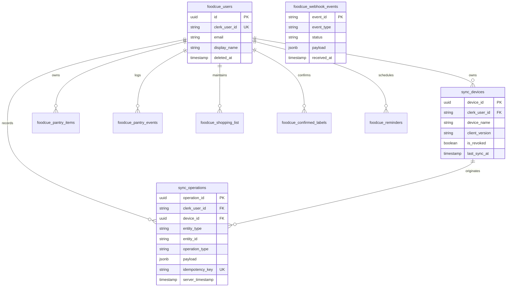

# FoodCue Neon Cloud Database Architecture & Schema Specification

```text
========================================================================================
MODULE:                Neon PostgreSQL Cloud Database Layer
SPECIFICATION:         FoodCue Master Specification v13.5 §15
ENVIRONMENT:           Neon Serverless PostgreSQL (ap-southeast-1)
CONNECTION TOPOLOGY:   Pooled Endpoint (Vercel Serverless) + Unpooled (DDL Migrations)
STATUS:                Production Migration 002 Applied & Verified
========================================================================================
```

---

## 1. Overview & Connection Architecture

FoodCue uses **Neon Serverless PostgreSQL** as its relational cloud storage and multi-device synchronization backend. In adherence to the **Zero-Cash Architecture**, FoodCue operates entirely within Neon's free tier with zero ongoing hosting expense.

### Dual-Endpoint Strategy:
1. **Pooled Connection (`DATABASE_URL`):**
   - Routes through Neon's PgBouncer pooling cluster (`...-pooler.c-4.ap-southeast-1.aws.neon.tech`).
   - Used by all Vercel Node.js serverless functions (`api/*`) to handle concurrency without connection starvation or cold-start timeouts.
2. **Unpooled Direct Connection (`DIRECT_DATABASE_URL`):**
   - Connects directly to PostgreSQL computational node (`...c-4.ap-southeast-1.aws.neon.tech`).
   - Required for transactional DDL migrations, table alterations, index creations, and schema ledger management.

---

## 2. Applied Database Migrations

### Migration `001_initial_users.sql`
- Creates `foodcue_users` with UUID primary key `id`, unique `clerk_user_id`, email, display name, username, and soft-delete timestamp `deleted_at`.
- Creates indexes on `clerk_user_id`, `email`, and `deleted_at`.

### Migration `002_sync_engine_and_devices.sql`
- **`foodcue_webhook_events`**: Idempotency ledger for Clerk webhook events. Contains `event_id`, `event_type`, `status`, `payload`, `error`, `received_at`.
- **`sync_devices`**: Multi-device management tracking `device_id` (UUID), `clerk_user_id`, `device_name`, `client_version`, `user_agent`, `last_sync_at`, `is_revoked`.
- **`sync_operations`**: Delta operation journal tracking `operation_id` (UUID), `clerk_user_id`, `device_id`, `entity_type`, `entity_id`, `operation_type`, `payload`, `client_timestamp`, `server_timestamp`, `idempotency_key` (UNIQUE).
- **Tenant Isolation**: Injects `clerk_user_id` and composite tenant indexes onto `foodcue_pantry_items`, `foodcue_pantry_events`, `foodcue_shopping_list`, `foodcue_reminders`, and `foodcue_confirmed_labels`.

---

## 3. Entity Relational Model



---

## 4. Multi-Tenant Horizontal Isolation Guarantees

Every data query hitting Neon via the serverless API enforces strict user ownership:
1. The incoming request presents a Clerk session token in the `Authorization: Bearer <jwt>` header.
2. The serverless function derives `clerk_user_id` from the verified token.
3. Every SQL read and write statement injects `WHERE clerk_user_id = $1`.
4. It is architecturally impossible for User A to observe, modify, or delete records belonging to User B.
