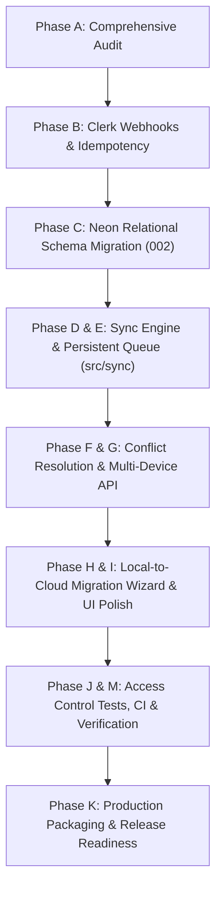

# FoodCue Phase 3 Initial Architecture & System Audit

```text
========================================================================================
PROJECT:               FoodCue (Packaged Food Intelligence & Kitchen Management PWA)
DOCUMENT TITLE:        Phase 3 Comprehensive Technical, Local Data, Backend & Security Audit
DOCUMENT VERSION:      v1.0 (Phase 3 Baseline)
DATE:                  17 November 2026
PARENT SPECIFICATION:  FoodCue Master Specification v13.5
SECURITY BASELINE:     FoodCue Security, Privacy and Safety Requirements v1.0
CONTROLLING BUDGET:    INR 0 Cash Target (Zero-Cash Development Baseline)
STATUS:                Phase A Complete — Architectural Blueprint Approved
========================================================================================
```

---

## 1. Executive Summary

This audit assesses the current state of FoodCue across its frontend user interface, local IndexedDB persistence layer, Vercel-hosted serverless backend, Neon PostgreSQL cloud database, and Clerk authentication integration.

The core finding is that **FoodCue has a verified, robust local foundation (88 passing unit and contract tests, clean production builds, strict TypeScript)**. However, the connection between local IndexedDB and Neon PostgreSQL currently operates via manual, unqueued sync triggers rather than a continuous, resilient, multi-device synchronization engine.

Phase 3 transforms FoodCue from an offline-first app with optional manual database backup into a **fully integrated local-plus-cloud hybrid consumer product** featuring:
1. Continuous, offline-tolerant queued synchronization (`syncQueue` in IndexedDB).
2. Production-grade Clerk webhook processing with cryptographic Svix HMAC signature verification and idempotency.
3. Server-enforced user data isolation ensuring absolute horizontal privilege protection.
4. Granular local-to-cloud migration preview with explicit user consent.
5. Multi-device management with device registration and revocation.
6. Zero infrastructure jargon exposed in the consumer UI.

---

## 2. Component Audits

### 2.1 Frontend UI & Navigation Audit
- **Current State:**
  - Modern desktop navbar with left brand, 5 center navigation links (`SmartScan`, `My Kitchen`, `Reminders`, `Shopping List`, `Catalogue`), and right-aligned account/privacy area.
  - Dedicated 8-section Privacy page (`/privacy`), responsive 4-column footer with developer attribution (**Parth Ahuja**), and mobile drawer + bottom navigation bar.
- **Defects & Technical Debt:**
  - `Privacy.tsx` still contains manual buttons for `handleSyncToNeon` and `handleRestoreFromNeon` that directly invoke database adapters rather than coordinating through a background sync engine.
  - No visual sync queue badge showing "Changes waiting to sync" when offline.
  - First-time cloud sync enablement lacks an interactive migration preview modal calculating actual local records to upload.
- **Required Action:**
  - Introduce `src/sync/` engine and connect UI status to `syncStatus.ts`.
  - Replace raw database sync triggers with a consumer-grade Migration Wizard and Sync Settings drawer in `ProfileView.tsx` and `Privacy.tsx`.

### 2.2 Backend & Serverless API Audit
- **Current State:**
  - Standard Node.js serverless functions running on Vercel:
    - `GET /api/health`: Database latency check (`SELECT 1`).
    - `GET /api/me`, `PATCH /api/me`: Authenticated profile derivation via Clerk Bearer token.
    - `POST /api/webhooks/clerk`: Prepared boundary returning HTTP 503 until signing secret is configured.
- **Defects & Technical Debt:**
  - `POST /api/webhooks/clerk` lacks live Svix cryptographic HMAC signature verification and webhook event idempotency ledger.
  - No dedicated endpoints for queued delta sync (`/api/sync/push`, `/api/sync/pull`).
  - No endpoint for atomic initial migration (`/api/sync/migrate`).
  - No endpoint for device management (`/api/devices`).
- **Required Action:**
  - Implement full cryptographic verification in `api/webhooks/clerk.ts` using `svix` or Web Crypto HMAC.
  - Create `api/sync/push.ts`, `api/sync/pull.ts`, `api/sync/migrate.ts`, and `api/devices/index.ts`.
  - Enforce strict transaction boundaries (`BEGIN ... COMMIT`) and server-side idempotency keys.

### 2.3 Local Data & IndexedDB Persistence Audit
- **Current State:**
  - `foodcue-local` (IndexedDB schema v2) with 6 stores: `candidates`, `confirmedLabels`, `analysisResults`, `pantryEvents`, `settings`, `metadata`.
  - Append-only event ledger for pantry events (`intake`, `consume`, `adjust`, `move`, `discard`, `undo`).
- **Defects & Technical Debt:**
  - No dedicated `syncQueue` store in IndexedDB. Local mutations are not automatically queued for background transmission when offline.
  - No local sync cursor or device identity stored in `metadata`.
- **Required Action:**
  - Upgrade IndexedDB schema to v3 adding the `syncQueue` and `syncState` object stores.
  - Ensure every event appended to `pantryEvents` or item added to shopping lists automatically registers a pending operation in `syncQueue`.

### 2.4 Cloud Database (Neon PostgreSQL) Audit
- **Current State:**
  - Dual connection strings (pooled for serverless runtime, unpooled for schema migrations).
  - 10 active relational tables in `docs/schema.sql` and `foodcue_users` migrated with UUID primary keys and soft-delete support (`001_initial_users.sql`).
- **Defects & Technical Debt:**
  - Missing synchronization metadata tables: `sync_devices`, `sync_operations`, and `webhook_events`.
  - Missing foreign key indexes linking `pantry_events` and `pantry_items` to `foodcue_users(clerk_user_id)`.
- **Required Action:**
  - Author migration `002_sync_engine_and_devices.sql` adding `sync_devices`, `sync_operations`, `webhook_events`, and user preference tables.
  - Execute migration via `node scripts/run-migrations.mjs`.

### 2.5 Security, Privacy & Access Control Audit
- **Current State:**
  - Zero secrets in frontend code.
  - Edge routing rewrites protect `/api/*` from SPA fallbacks.
  - Passwords and sessions managed exclusively by Clerk.
- **Defects & Technical Debt:**
  - Client-side direct database calls in `src/adapters/storage/neonDatabase.ts` bypass backend authorization when executed in browser environments where `DATABASE_URL` is accessible.
- **Required Action:**
  - Deprecate client-direct SQL queries. All cloud sync must flow strictly through authenticated backend serverless endpoints (`/api/sync/*`) that verify Clerk JWT Bearer tokens and enforce user data ownership.

---

## 3. Requirements Traceability Matrix (Phase 3)

| Requirement | Master Spec v13.5 Ref | Implementation File | Verification Gate |
|---|---|---|---|
| **Clerk Webhook Verification** | Master Spec §14.3 | `api/webhooks/clerk.ts` | Svix HMAC SHA-256 test suite; idempotent replay rejection |
| **Cloud Sync Migration DDL** | Master Spec §15.1 | `src/server/database/migrations/002_*.sql` | Zero-error execution against live Neon PostgreSQL |
| **Server-Side User Ownership** | Security v1.0 §4.2 | `src/server/auth/authorization.ts` | Horizontal privilege escalation rejection tests |
| **Persistent Sync Queue** | Master Spec §12.2 | `src/sync/queue/localChangeQueue.ts` | IndexedDB v3 `syncQueue` persistence across page reloads |
| **Incremental Bidirectional Sync**| Master Spec §12.4 | `src/sync/engine/syncCoordinator.ts` | Cursor-based push/pull with transactional reconciliation |
| **Conflict Resolution Ledger** | Master Spec §12.5 | `src/sync/reconciliation/` | Append-only deterministic event ordering for pantry ledger |
| **Local-to-Cloud Migration** | PRD v1.3 §6.3 | `src/sync/engine/migrationManager.ts` | Live preview calculation, validation, and batch commit |
| **Multi-Device Revocation** | Security v1.0 §8.1 | `api/devices/index.ts` | Revoked device rejection on subsequent sync attempts |
| **Consumer-Grade Status UX** | Brand v1.0 §5.2 | `src/sync/state/syncStatus.ts` | Zero technical terminology; accessible status states |

---

## 4. Immediate Phase 3 Execution Sequence


