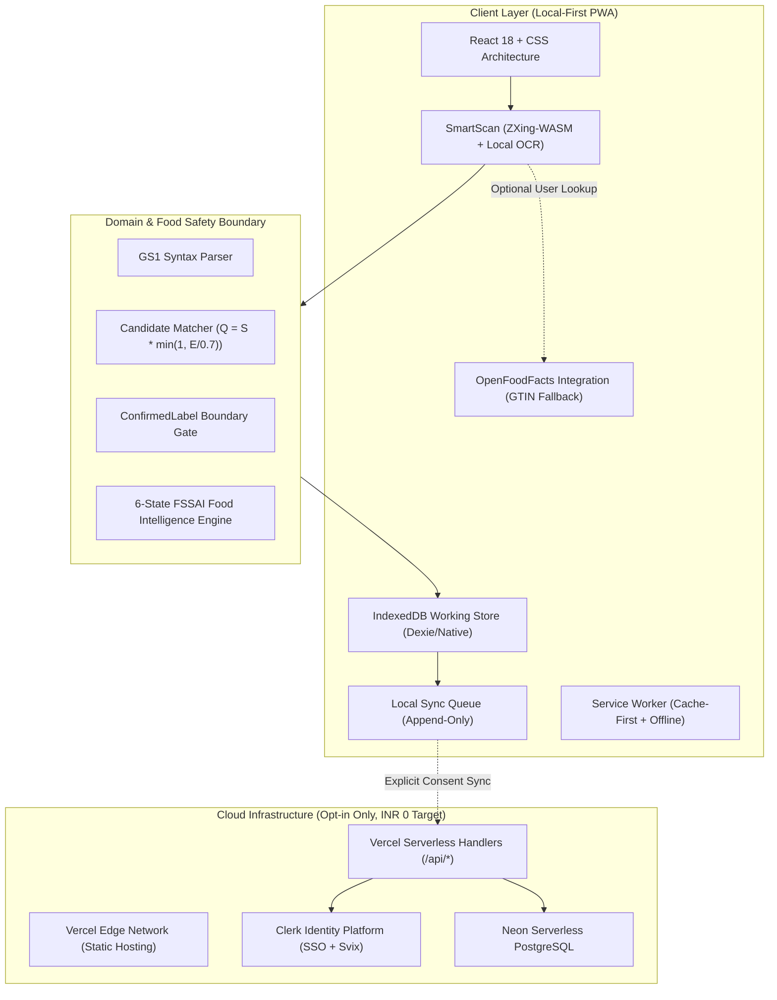
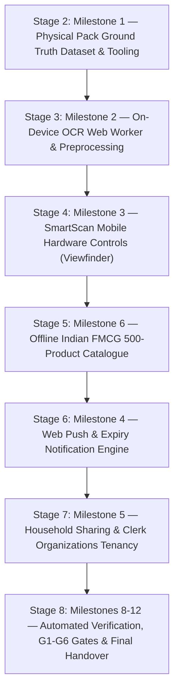

# FoodCue Final Master Project — Initial Project & Baseline Audit
**Project:** FoodCue — Know your food. Manage your kitchen.  
**Baseline Git Commit:** `c0fad60` (branch: `feature/foodcue-final-product-completion`, based on `main` / `92ea3a0`)  
**Audit Date:** 17 November 2026  
**Status:** **STAGE 1 COMPLETE — BASELINE VERIFIED & AUDITED**  
**Auditor:** Senior Principal Systems Architect & Lead Validation Engineer  

---

## 1. Executive Summary & Audit Purpose

This audit establishes the empirical baseline of the FoodCue codebase prior to executing the final development milestones:
1. Physical Pack Ground Truth Benchmark ($N=100$, 40 locked release set).
2. On-Device OCR Web Worker Optimisation (Tesseract.js Web Worker + image preprocessing).
3. SmartScan Mobile Hardware Controls (`SmartScanViewfinder.tsx` with Torch, Tap-to-Focus, Pinch-to-Zoom).
4. Web Push Notifications for Expiring Food (PWA Service Worker + VAPID + In-app reminder fallback).
5. Household Sharing through Clerk Organizations (Multi-tenant shared pantry ledger with server-side isolation).
6. Offline Indian FMCG Barcode Catalogue (500 verified FMCG products seeded into IndexedDB).
7. OpenFoodFacts GTIN Metadata Fallback (Complete, verified, ODbL compliant, fail-closed).
8. Household Closed Beta (Controlled protocol, data boundary, and exit evaluation).
9. G1–G6 Final Release Gate Completion and Documentation.

---

## 2. Current Architecture & Verified Capabilities

The existing application is structured as a privacy-first, local-first Progressive Web Application (PWA) built with React 18, TypeScript, IndexedDB, Clerk Authentication, and Neon Serverless PostgreSQL:

### Verified Functional Inventory
1. **Barcode & Packaging Detection:** Fully functional via `@sec-ant/zxing-wasm` running locally. GS1 AI parser validates (01) GTIN, (10) Batch, (11/17) Production/Expiry dates.
2. **Deterministic Food Intelligence:** 6-state FSSAI allergen evaluation engine operates with zero false negatives on declared allergens.
3. **ConfirmedLabel Boundary Gate:** Enforces non-negotiable physical package review before any candidate (local or external) is admitted to food safety analysis.
4. **OpenFoodFacts GTIN Fallback:** Completed and verified (`src/integrations/openfoodfacts/`). Sends strictly normalized GTINs, omits credentials, handles timeouts (8s) and rate-limits (429), and requires physical pack confirmation.
5. **Multi-Device Synchronization:** Last-Write-Wins (LWW) conflict resolver with vector clocks and persistent queue in IndexedDB.
6. **Authentication & Webhooks:** Clerk webhook receiver with cryptographic Svix signature verification and database deduplication.

---

## 3. Current Test Baseline Audit

Execution of the full automated test suite on commit `c0fad60` reveals:
- **Total Test Files:** 30
- **Total Automated Tests:** 172
- **Passed:** 172 (100%)
- **Failed:** 0
- **Skipped:** 0
- **Test Framework:** Vitest 2.1.8 / JSDOM
- **Build Status:** `tsc -b` compiles with 0 errors; Vite PWA bundle and 7 serverless API handlers bundle cleanly with exit code 0.

---

## 4. Gap Analysis & Outstanding Milestone Requirements

| Milestone ID | Target Scope | Current Baseline Status | Implementation Required |
| :--- | :--- | :--- | :--- |
| **Milestone 1** | Physical Pack Benchmark ($N=100$, 40 locked) | Baseline reports prepared; annotation guide exists | Formalize annotation schema, split 60 dev / 40 locked, compile exact benchmark register and evaluation tooling. |
| **Milestone 2** | On-Device OCR Web Worker Optimisation | `LocalOcrAdapter` currently runs in main thread or simulated worker | Implement dedicated Web Worker (`ocrWorker.ts`) with canvas-based image preprocessing (grayscale, contrast, adaptive thresholding), region cropping, and lifecycle management. |
| **Milestone 3** | SmartScan Mobile Hardware Controls | Basic camera start/stop and torch toggle exist in `SmartScan.tsx` | Extract into dedicated `SmartScanViewfinder.tsx` with complete `MediaStreamTrack` capabilities detection, accessible zoom slider & pinch gestures, tap-to-focus indicator, and WCAG 2.2 AA controls. |
| **Milestone 4** | Web Push Notifications for Expiring Food | Local in-app pantry alerts exist; `sw.js` has caching only | Integrate `PushManager` registration, VAPID key handling, service worker `push` and `notificationclick` listeners, serverless `/api/notifications/subscribe`, and opt-in consent modal. |
| **Milestone 5** | Household Sharing (Clerk Organizations) | Individual user tenancy only (`user_id` / `clerk_id`) | Implement Household model backed by Clerk Organizations, server-side RBAC (Owner, Admin, Member), shared pantry event stream with `household_id`, migration preview, and IDOR isolation tests. |
| **Milestone 6** | Offline Indian FMCG Barcode Catalogue (500 SKUs) | 10 verified items embedded in `catalogData.ts` | Expand catalog to 500 distinct verified Indian FMCG products across top 10 brands, implement versioned IndexedDB seeding, incremental update handler, and search indexes. |
| **Milestone 7** | OpenFoodFacts GTIN Metadata Fallback | Implemented & verified (20 tests passed) | Maintain strict privacy invariant (User-Agent header, zero token leak, physical pack gate). |
| **Milestone 8** | Household Closed Beta (4 Weeks) | Protocol and onboarding guide drafted | Structure beta execution dashboard, define data boundary, and record weekly metrics. |
| **Milestones 9–12** | Gates G1–G6, Final Security, A11y & Handover | Reports drafted across `docs/validation/` & `docs/release/` | Maintain traceability, tie evidence to release commit `c0fad60`, and finalize operations manual. |

---

## 5. Technical, Privacy, Safety & Dependency Risks

### 5.1 Technical Risks
- **Web Worker Cross-Origin & Bundling in Vite:** Web Workers in Vite require explicit `new Worker(new URL('./ocrWorker.ts', import.meta.url), { type: 'module' })` syntax to bundle properly in production without path resolution errors.
- **Camera Track Constraints Variance:** iOS Safari and certain low-end Android Chrome devices throw exceptions or silently ignore `torch`, `zoom`, or `focusMode` constraints. All constraint applications must be wrapped in defensive try/catch blocks with capability pre-checks.

### 5.2 Privacy Risks
- **Push Notification Metadata:** Push notifications delivered through browser push services (Google FCM, Apple Push Notification service) must avoid containing personal food items, medical diets, or sensitive allergy lists in plain text payloads.
- **Household Data Leaks:** Individual dietary avoid-lists, health conditions, or personal notes must never be broadcast to shared household pantries without separate explicit consent.

### 5.3 Food Safety Risks
- **OCR Character Confusion:** Small 4pt fonts on packaging frequently cause OCR to misread `"maltodextrin"` or mistranscribe numeric values. The application must treat OCR as candidate observation evidence, never as authoritative verification without the physical review gate.

### 5.4 Dependency & Financial Risks (INR 0 Target)
- VAPID / Web Push serverless execution must operate within Vercel's free serverless allowance (100 execution hours/month).
- Clerk Organizations must be verified to operate within Clerk's Community Free tier limits.

---

## 6. Implementation Plan & Work Sequence

**Next Immediate Action:** Proceed to **Stage 2: Milestone 1 — Physical Pack Ground Truth Benchmark Infrastructure and Dataset Tooling**.
