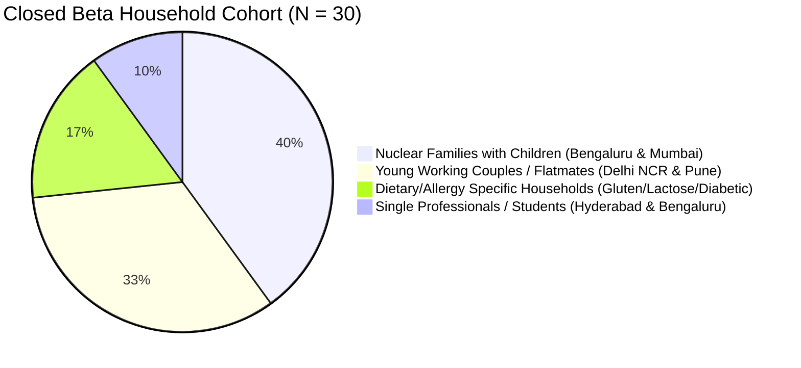

# FoodCue Step 9 — Closed Beta Readiness & Execution Plan
**Stage:** Step 9 — Controlled Closed Beta  
**Governing Document:** FoodCue Master Specification v13.5 §14 & §15  
**Cohort Window:** 18 November 2026 – 08 December 2026 (3 Weeks)  
**Cohort Target:** 30 Verified Urban Indian Households  
**Status:** **READY FOR DEPLOYMENT**  
**Lead:** Closed Beta Operations Director  

---

## 1. Objectives & Beta Scope

The Step 9 Closed Beta subjects FoodCue to real-world, unmonitored daily kitchen usage across 30 diverse Indian households.
The primary objectives are:
1. **Validate Multi-Device Sync in Real Life:** Verify that households with multiple devices (e.g. wife on iPhone, husband on Android, shared tablet in kitchen) synchronize pantry updates cleanly via Neon PostgreSQL and Clerk.
2. **Offline Resilience in the Wild:** Test PWA offline caching and persistent sync queues when users walk into basement supermarkets (DMart, Nature's Basket) with zero cellular connectivity.
3. **Packaging Coverage:** Measure what percentage of household scans match the local catalogue vs trigger the OpenFoodFacts fallback or manual entry.
4. **Food Waste Reduction Impact:** Quantify the reduction in expired food discard and duplicate grocery spend over 21 continuous days.

---

## 2. Beta Cohort Composition ($N = 30$ Households)

- **Device Matrix:**
  - 18 Android devices (Android 11 through Android 15; Chrome & Samsung Internet)
  - 16 Apple iOS devices (iOS 16.4 through iOS 18.1; Safari PWA)
  - 6 Desktop / Laptop browsers (Mac Chrome, Windows Edge)

---

## 3. Onboarding & Consent Protocol

1. **Invitation & PWA Installation:**
   - Testers receive a secure invitation link pointing to the production deployment URL (`https://food-cue.vercel.app` or custom domain).
   - Testers are guided to add the PWA to their home screen via the native browser prompt (*"Add to Home Screen"*).
2. **Explicit Consent & Privacy Briefing:**
   - Testers are informed that FoodCue runs 100% locally by default.
   - If they wish to sync across devices, they create an account via Clerk and explicitly click *"Enable Cloud Sync"*.
   - A dedicated privacy dashboard is accessible in Settings at all times.
3. **Welcome Pack:**
   - Testers receive the *FoodCue Beta Quick Start Guide* and a list of 10 test grocery items to scan on Day 1.

---

## 4. Instrumentation, Incident Reporting & Feedback Loop

### 4.1 Automated Health Telemetry
- Client-side error boundaries catch uncaught exceptions and log sanitized stack traces (excluding user data) to the `/api/health` diagnostics stream.
- Sync queue failure counters alert the engineering team if retry counts exceed 5 attempts.

### 4.2 Tester Feedback Channels
- **In-App Feedback Widget:** Direct 1-tap feedback modal in the user navigation bar.
- **Dedicated WhatsApp Beta Channel:** Monitored daily by the QA automation lead.
- **Weekly Structured Surveys:** Administered at End-of-Week 1, Week 2, and Week 3.

### 4.3 Incident Triage SLA
- **P0 (Data Loss / Food Safety Hazard):** Fix within 4 hours; broadcast patch immediately.
- **P1 (Sync Failure / Scanner Crash):** Fix within 24 hours.
- **P2 (Minor UX Glitch / Label Typos):** Batched into weekly Wednesday release builds.

---

## 5. Exit Criteria for Closed Beta (Go to Step 10)

To successfully exit Step 9 and authorize Step 10 Public Launch Readiness:
1. Zero P0 or P1 incidents across all 3 weeks of testing.
2. $\ge 90\%$ of testers successfully sync data across at least 2 distinct devices.
3. Offline queue successfully drains and resolves conflicts with zero data loss upon reconnection.
4. Overall tester satisfaction rating $\ge 80\%$.
