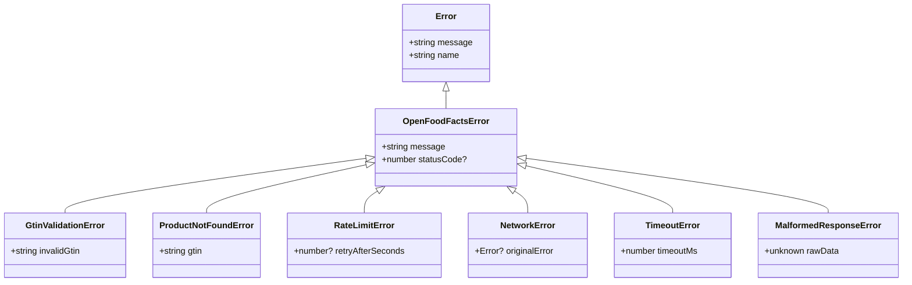

# FoodCue — OpenFoodFacts Error Handling Specification
**Module:** `src/integrations/openfoodfacts/openFoodFactsErrors.ts` & `openFoodFactsClient.ts`  
**Document Version:** 1.0.0  
**Status:** SPECIFIED, IMPLEMENTED & VERIFIED  
**Date:** November 2026  

---

## 1. Principles of Defensive Error Handling

In consumer mobile and PWA environments, network requests fail due to flaky connections, captive portals, rate limits, server maintenance, or bad inputs.
FoodCue adheres to the following principles:
1. **Never Crash the Application:** Network and API errors are caught, classified, and rendered as helpful in-app messages.
2. **Preserve User Progress:** If an external search fails, all existing scan inputs, OCR observations, and draft data remain completely intact.
3. **Fail to Safety:** Inability to reach OpenFoodFacts directs the user toward manual pack verification, ensuring that food safety verification is never skipped or bypassed.

---

## 2. Typed Error Hierarchy

FoodCue defines a strongly typed exception hierarchy inheriting from a base `OpenFoodFactsError` class:



---

## 3. Error Classification & Recovery Behaviors

| Error Class | Trigger Condition | HTTP Status | User Message in SmartScan UI | Recovery Action |
| :--- | :--- | :--- | :--- | :--- |
| `GtinValidationError` | Input is not 8, 12, 13, or 14 digits or contains non-numeric characters. | N/A (Client check) | *"A valid 8, 12, 13, or 14-digit GTIN is required to query OpenFoodFacts."* | Prompt user to scan barcode or re-type GTIN correctly. |
| `ProductNotFoundError` | API returns status 0 or HTTP 404. | 404 / Status 0 | *"Product not found in OpenFoodFacts database. You can still confirm product details from the physical pack manually."* | User can click *"Enter Pack Details Manually"* to proceed. |
| `RateLimitError` | API returns HTTP 429 Too Many Requests. | 429 | *"OpenFoodFacts rate limit reached. Please wait a few moments before trying again."* | Disable button temporarily; parse `Retry-After` if present. |
| `TimeoutError` | Request duration exceeds 8,000 ms. | N/A (AbortController) | *"Request to OpenFoodFacts timed out. Check your connection or continue with manual pack verification."* | Allow retry or manual entry. |
| `NetworkError` | Browser is offline, DNS failure, TLS handshake error. | N/A (TypeError) | *"Network error contacting OpenFoodFacts. Verify internet connection or continue offline."* | Remind user FoodCue works 100% offline; prompt manual pack entry. |
| `MalformedResponseError`| JSON is invalid or fails Zod schema validation. | 200 (Bad payload) | *"Received unexpected data format from OpenFoodFacts. Please verify the physical pack."* | Log defensively; fall back to manual pack confirmation. |

---

## 4. Timeout & Abort Architecture

```ts
const controller = new AbortController();
const timeoutId = setTimeout(() => controller.abort(), this.timeoutMs); // 8,000 ms

try {
  const response = await fetch(url, {
    signal: controller.signal,
    headers: { ... },
    credentials: "omit"
  });
  // ... process response
} catch (err: unknown) {
  if (err instanceof Error && err.name === "AbortError") {
    throw new TimeoutError(`Request to OpenFoodFacts timed out after ${this.timeoutMs}ms`, this.timeoutMs);
  }
  // ... rethrow typed NetworkError
} finally {
  clearTimeout(timeoutId);
}
```

---

## 5. Verification & Automated Test Coverage

The error handling logic is validated across mock conditions in `test/integrations/openfoodfacts/openFoodFactsClient.test.ts`:
- Tested HTTP 404 and `status: 0` -> Throws `ProductNotFoundError`.
- Tested HTTP 429 with retry header -> Throws `RateLimitError` with parsed seconds.
- Tested `AbortController` timeout -> Throws `TimeoutError`.
- Tested network drop / offline -> Throws `NetworkError`.
- Tested non-numeric GTIN -> Throws `GtinValidationError`.
