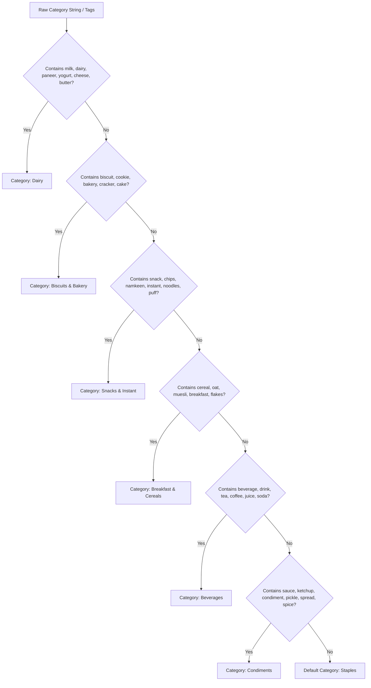

# FoodCue — OpenFoodFacts Field Mapping Specification
**Module:** `src/integrations/openfoodfacts/openFoodFactsMapper.ts`  
**Document Version:** 1.0.0  
**Status:** SPECIFIED, IMPLEMENTED & VERIFIED  
**Date:** November 2026  

---

## 1. Overview

OpenFoodFacts payloads are crowdsourced, multilingual, and semi-structured. Field names, units, and representations vary widely across different countries and contributors.

This document details the exact transformations implemented in `openFoodFactsMapper.ts` to convert a raw OpenFoodFacts JSON response into FoodCue's internal entities:
1. `OpenFoodFactsProductCandidate` (Internal integration model)
2. `ProductCandidate` (Domain entity for initial candidate resolution)
3. `VerifiedFoodProduct` (Domain entity adapted for candidate comparison and ranking)

---

## 2. Field-by-Field Mapping Table

| OpenFoodFacts API Attribute | FoodCue Target Field | Data Type | Transformation & Fallback Logic |
| :--- | :--- | :--- | :--- |
| `code` / `product.code` | `gtin` | `string` | Normalized GTIN (8, 12, 13, or 14 digits). Defaults to `"unknown"`. |
| `product.product_name` | `productName` | `string` | Fallback chain: `product_name` -> `product_name_en` -> `generic_name` -> `"Packaged Food Item"`. Stripped of excess whitespace. |
| `product.brands` | `brand` | `string` | Takes first comma-separated brand name. Defaults to `"External Manufacturer"`. |
| `product.quantity` | `packSize` | `string` | Raw quantity string (e.g. `"500 g"`, `"1 L"`). Defaults to `"Standard Pack"`. |
| `product.categories` / `categories_tags` | `category` | `enum` | Normalized via keyword pattern matching into one of 7 categories: `"Dairy"`, `"Biscuits & Bakery"`, `"Snacks & Instant"`, `"Breakfast & Cereals"`, `"Beverages"`, `"Condiments"`, or `"Staples"`. |
| `product.ingredients_text` | `ingredientsText` | `string` | Fallback chain: `ingredients_text` -> `ingredients_text_en` -> `""`. |
| `product.allergens_tags` / `allergens` | `allergensDeclared` | `string[]` | Strips language tags (e.g. `"en:milk"` -> `"Milk"`), replaces hyphens with spaces, capitalizes words, and deduplicates. |
| `nutriments.energy-kcal_100g` | `nutritionPer100g.energyKcal` | `number` | Direct kcal if present. If only `energy_100g` (kJ) is present, divides by 4.184 and rounds. Defaults to `0`. |
| `nutriments.proteins_100g` | `nutritionPer100g.proteinG` | `number` | Numeric value. Defaults to `0`. |
| `nutriments.carbohydrates_100g` | `nutritionPer100g.carbohydratesG`| `number` | Numeric value. Defaults to `0`. |
| `nutriments.sugars_100g` | `nutritionPer100g.totalSugarsG` | `number` | Numeric value. Defaults to `0`. |
| `nutriments.fat_100g` | `nutritionPer100g.totalFatG` | `number` | Numeric value. Defaults to `0`. |
| `nutriments.saturated-fat_100g` | `nutritionPer100g.saturatedFatG`| `number` | Numeric value. Defaults to `0`. |
| `nutriments.sodium_100g` / `salt_100g`| `nutritionPer100g.sodiumMg` | `number` | If `sodium_100g` exists, multiplies by 1,000 (g to mg). Else if `salt_100g` exists, multiplies by 400. Defaults to `0`. |
| N/A | `fssaiLicence` | `string` | Explicitly marked: `"Not Verified (External Data)"`. External sources cannot verify Indian FSSAI statutory licenses. |
| N/A | `sourceVerification` | `string` | Set to `"openfoodfacts_unverified_metadata"`. |
| `product.image_front_url` | `imageUrl` | `string?` | Optional thumbnail URL for visual confirmation in the candidate card. |

---

## 3. Category Mapping Rules

---

## 4. Verification Evidence

The mapping rules are tested against real-world sample payloads in `test/integrations/openfoodfacts/openFoodFactsMapper.test.ts`:
- Verified correct mapping of raw GTIN, English and localized product names.
- Verified parsing of multi-source calories (kcal vs kJ conversion).
- Verified tag stripping and formatting of declared allergens.
- Verified fallback defaults when fields are absent or malformed.
