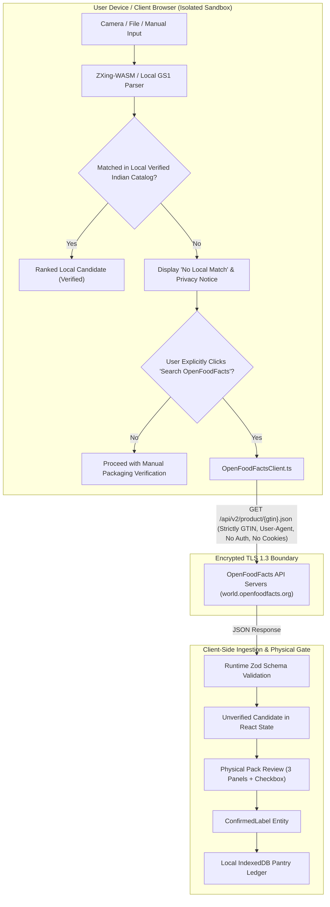

# FoodCue — OpenFoodFacts Privacy & Data Flow Analysis
**Controlling Principles:** Privacy by Design · GDPR / DPDP Act 2023 Compliance · Minimal Data Disclosure  
**Document Version:** 1.0.0  
**Status:** APPROVED & TESTED  
**Date:** November 2026  

---

## 1. Privacy Architecture & Threat Assessment

FoodCue was designed from Day 1 as an offline-first, local-first consumer application. Under the FoodCue Privacy Covenant:
- Users can run FoodCue completely offline indefinitely without ever creating an account.
- When an account is created via Clerk, all cloud sync to Neon PostgreSQL remains strictly opt-in and requires explicit consent.
- Any outgoing external network request must adhere to the principle of strict data minimization.

When integrating an external data source such as OpenFoodFacts, there is an inherent risk that third-party servers could correlate user IP addresses, timestamps, and food choices to create behavioral profiling records.

This document formally records the privacy controls, network boundaries, and cryptographic isolation implemented for OpenFoodFacts requests.

---

## 2. Information Sent vs. Withheld

The following table details every piece of user and application data, and confirms whether it is transmitted to OpenFoodFacts:

| Data Element | Transmitted to OpenFoodFacts? | Rationale & Protection Mechanism |
| :--- | :--- | :--- |
| **Normalized GTIN** | **YES (Only Item)** | Sent in the URL path (`/api/v2/product/{gtin}.json`) to query product packaging details. |
| **Clerk User ID / JWT** | **STRICTLY NO** | `credentials: "omit"`; no `Authorization` header attached. |
| **User Email / Name** | **STRICTLY NO** | Excluded from client payload; no query params sent. |
| **Cookies / LocalStorage** | **STRICTLY NO** | `credentials: "omit"` prevents cookie header transmission. |
| **User Device / Hardware ID** | **STRICTLY NO** | Generic User-Agent header `FoodCue-PWA/1.0` used. |
| **Camera Feed / Frames** | **STRICTLY NO** | Barcode decoding runs 100% locally in WebAssembly (`@sec-ant/zxing-wasm`). |
| **OCR Text / Raw Photographs**| **STRICTLY NO** | OCR runs 100% locally in client Web Workers (`tesseract.js`). |
| **Existing Kitchen / Pantry List**| **STRICTLY NO** | Pantry and inventory data resides strictly in browser IndexedDB. |
| **GPS / Geolocation** | **STRICTLY NO** | FoodCue requests zero geolocation permissions. |
| **IP Address** | **Incidental (HTTPS)** | Inherent to standard TCP/IP networking. Encrypted via TLS 1.3 to OpenFoodFacts edge servers. |

---

## 3. Data Flow Diagram

---

## 4. Technical Privacy Verification

To verify that the privacy requirements are continuously enforced and prevent regression in future builds, FoodCue maintains dedicated automated tests in `test/integrations/openfoodfacts/openFoodFactsPrivacy.test.ts`:

1. **Header Inspection:**
   - Asserts that outgoing fetch requests never contain `Authorization`, `Cookie`, `X-User-Id`, or other tracking headers.
   - Asserts that `credentials` is set to `"omit"`.
2. **Query Parameter Inspection:**
   - Asserts that the URL only contains the whitelist parameter `?fields=...` and never leaks user identity, coordinates, or search history.

---

## 5. Regulatory Compliance Assessment

- **India Digital Personal Data Protection Act, 2023 (DPDP Act):**
  - FoodCue does not collect, process, or transmit personal data to OpenFoodFacts.
  - Queries constitute anonymous product identifier lookups.
- **EU General Data Protection Regulation (GDPR):**
  - Conforms to Article 25 (Data protection by design and by default) and Article 5(1)(c) (Data minimization).
