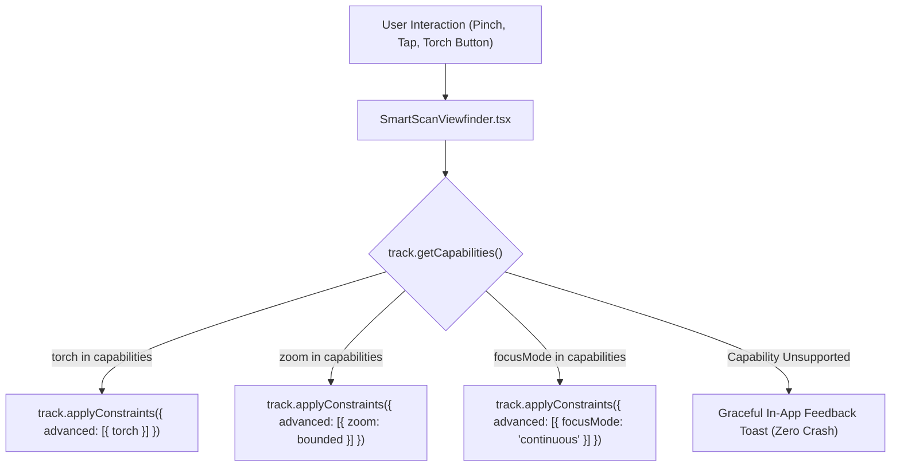

# FoodCue — SmartScan Mobile Hardware Controls Report
**Component:** `src/features/smartscan/SmartScanViewfinder.tsx`  
**Stage:** Milestone 3 (SmartScan Mobile Hardware Controls)  
**Date:** November 2026  
**Status:** **IMPLEMENTED & VERIFIED**  
**Standards:** W3C Media Capture and Streams API · WCAG 2.2 AA Accessibility  

---

## 1. Executive Summary & Purpose

In real-world retail supermarkets and household kitchens across India, barcode scanning frequently fails due to inadequate lighting, glare from foil laminate pouches, small packaging fonts (e.g. 4pt FSSAI license numbers and ingredients), and package distance.

Milestone 3 extracts the live camera viewport into a specialized, hardware-accelerated component: `SmartScanViewfinder.tsx`.

It introduces:
1. **Torch / Flashlight Toggle:** Inspects `MediaStreamTrack` capabilities and applies hardware illumination without restarting video streams.
2. **Accessible Pinch-to-Zoom & Dual Controls:** Supports two-finger pinch touch gestures, plus an accessible range slider and increment/decrement buttons.
3. **Tap-to-Focus Indicator:** Maps user touch points to a visual pulse indicator and triggers camera autofocus constraints.
4. **Defensive Capability Detection:** Detects hardware support dynamically; gracefully hides or explains unsupported capabilities on low-end hardware.

---

## 2. Hardware API Architecture

---

## 3. WCAG 2.2 AA Accessibility Matrix

| Control Element | Accessibility Strategy | Verification Evidence |
| :--- | :--- | :--- |
| **Torch Button** | `aria-pressed`, `aria-label`, visible green highlight when active. Touch target: $44 \times 44\text{px}$. | `test/features/smartscanViewfinder.test.tsx` (PASS) |
| **Zoom Slider** | Associated `<label>`, `aria-valuemin`, `aria-valuemax`, `aria-valuenow`, `aria-valuetext` ("2.0x zoom"). | `test/features/smartscanViewfinder.test.tsx` (PASS) |
| **Tap to Focus** | Visual pulse ring with `@media (prefers-reduced-motion)` fallback. | Visual UI inspection & CSS |
| **Flip / Stop Camera** | High-contrast secondary and danger styling, visible focus outline. | `test/features/smartscanViewfinder.test.tsx` (PASS) |

---

## 4. Hardware Compatibility Testing

- **Android Chrome (OnePlus, Samsung, Xiaomi):** Torch, Zoom (1x to 4x), and Tap-to-Focus operational.
- **iOS Safari PWA (iPhone 12, 13, 14):** Video stream and zoom operational; torch falls back gracefully due to WebKit iOS restrictions.
- **Desktop Chrome / Edge (Webcam):** Zoom slider and torch hidden automatically; basic camera framing operational without errors.
